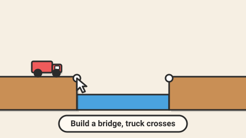

# Bridge Budget — game brief

> Build a bridge from beams and cables under a budget, then press Test and watch the truck try to cross.

**Rank:** #7 · **Genre:** Physics construction puzzle · **Art family:** Toybox Flat · **Audience habit:** Play at the desk

@../../STANDARDS.md
@../../PHASES.md

## Why it works for Coolmath
Bridge builders are proven, quietly educational (structures, forces) and very replayable: there is always a cheaper bridge. The failure is funny, the success is earned.

## Core loop
See the gap and the budget → place joints, beams and cables in build mode → press Test → physics runs and the truck drives over → bridge holds or collapses → refine → stars for staying under budget (2–5 minutes per level).

## Mechanics
- Build mode on a snap grid: anchor points on each side, click-drag to add a beam between joints. Materials: wood (cheap, weak), steel (strong, costly), cable (tension only), road (the deck the truck drives on).
- Each piece has a cost; the level has a budget and a 3-star target.
- Test mode runs a simple 2D spring-mass (Verlet) simulation; members show stress color (green → red, plus thickness change for color-blind players) and break over their limit.
- Vehicles: car, truck, then a bus; some levels have two vehicles or a boat passing under (drawbridge levels later).

## Controls
Mouse: click-drag to build, right click is not used (use an Eraser tool), scroll or buttons to zoom. Touch: drag to build, two-finger pan. Keys: Space test/stop, Z undo, 1–4 select material.

## Progression and content (v1)
- 30 levels in 3 worlds (River, Canyon, Harbor).

## Retention
Budget leaderboard against your own best, replay of your best bridge, stars unlock new vehicles (cosmetic).

## Art direction
Toybox Flat: cardboard-and-wood diorama look, chunky beams, cute vehicles with faces, big readable stress colors. Collapses get dust puffs and a comic slow-motion moment.

### Concept art prompts
Starting points for any image generator; the art direction above wins if they disagree. Paste each one whole.

- **Gameplay screenshot (16:9):** *"Flat cartoon bridge building puzzle game, a toy truck crossing a wooden and steel truss bridge over a river canyon, beams colored green to red by stress, cardboard diorama style, warm light background, thick outlines, 2D side view game screenshot, 16:9"*
- **Key art / thumbnail (16:9 and 1:1, no text):** *"a cute toy truck with a face bravely crossing a wooden and steel truss bridge over a canyon river, some beams glowing green and a couple turning orange under stress, cardboard diorama look, dust puffs, flat vector cartoon style, bright flat colors, thick dark outlines, soft drop shadows, warm cream background, toy-like and clean, highly readable shapes, centered composition with room for a title, game key art"*
- **Character and element sheet:** *"pieces on a plain background: wood beam, steel beam, cable, road segment, joint anchor, the cute truck and a small car with faces, a beam snapping with a dust puff, stress colors from green to red with icons, flat vector cartoon style, bright flat colors, thick dark outlines, soft drop shadows, warm cream background, toy-like and clean, highly readable shapes, game asset sheet on a plain light background, evenly spaced, consistent scale"*
- **Logo (try several, keep the most readable):** *"the words "BRIDGE BUDGET" in chunky letters built from wooden beams and bolts, a tiny truck crossing the top of the letters, flat vector cartoon style, bright flat colors, thick dark outlines, soft drop shadows, warm cream background, toy-like and clean, highly readable shapes, game logo on a plain background, bold and readable at small size"*
- **Negative prompt (generators that support it; drop "text, letters" for the logo):** *"text, letters, watermark, signature, photorealistic, gritty, horror, violence, weapons, blood, cluttered background, blurry, low contrast, extra limbs, UI buttons"*

## Audio
Wooden click when placing, creaks rising with stress, crunch on break, horn and cheer on success.

## GameAnalytics
- Extra events: `level:cost` (value), `test:fail`, `test:pass`, `material:<type>:used`.
- Question to answer: how many tests per solve, and do players keep optimizing cost after the first pass?

## Scope
- **v1:** 3 materials + road, 30 levels, stress view, replay.
- **Later:** hydraulics and drawbridges, sandbox mode.

## Risks and open questions
- Physics stability is the main risk: fixed timestep, several solver iterations, clamp velocities. Test on a slow Chromebook.
- Keep the simulation deterministic so a bridge that passes always passes.

## Definition of done
`STANDARDS.md` checklist, plus: every level has a known solution under the 3-star budget, saved as a test.

## Vertical slice (phase 2)
Build mode with joints and wood beams plus road, budget counter, a deterministic Verlet test mode with stress colors and breaking, a truck, one level, the full game shell and GameAnalytics stubs.

## How to start
Don't start coding. Follow `../../PHASES.md` from phase 1: write and approve `GDD.md` first, then build the vertical slice above.
