# Chess Defense — game brief

> Tower defense on a chessboard: every piece attacks exactly the squares its chess move reaches.

**Rank:** Prototype · **Genre:** Tower defense · **Art family:** Wooden Chessboard · **Audience habit:** Play at the desk

The game calls itself **Gambit Defense** on screen and in the build. The folder and dashboard use Chess Defense. Pick one name in the GDD. **[confirm]**

@../../STANDARDS.md
@../../PHASES.md

## Why it works for Coolmath
Everyone knows how chess pieces move, so the towers explain themselves: a rook shoots along its rank and file, a bishop along its diagonals, a knight on its L-squares. Placing pieces becomes a small chess puzzle. Sliding pieces are blocked by other pieces, bishops never leave their square color, and some creeps only walk one color. It rewards thinking, which fits Coolmath's logic and strategy audience, and a run can go as long as the player survives.

## Core loop
Pick a board → 20 s of prep: spend gold on pieces and place them on free squares → a wave walks the route toward the King → pieces shoot creeps on their attack squares; kills pay gold → after each cleared wave, pick 1 of 3 free pieces (each with a signature ability) and place it → next prep. A creep that reaches the King takes King HP (20 to start). The run ends when the King falls; the best wave reached is saved per board. A run lasts about 10–20 min **[confirm]**.

## Mechanics
As built. The comment at the top of `game.js` and `constants.js` explain the rules in more detail.
- **Pieces as towers:** Pawn (12 gold), Knight (28), Bishop (34), Rook (46), Queen (100). The attack range is the move pattern. Bishop, Rook and Queen slide and hit only the first enemy on each line; other pieces block them. Knights jump past everything.
- **Square color:** Pawns and Bishops only ever attack their own square color, Knights only the opposite color, Rooks and Queens both. Warded creeps (Alabaster on light, Obsidian on dark) hop two squares at a time, so they never leave their color. A piece that cannot attack that color never gets a shot.
- **Moving pieces:** a placed piece can move to any square it attacks, as often as you like, including route squares. A piece on the route deals ×2 damage, but the first creep that reaches it tramples it. A trampled piece slows the creep that killed it.
- **Upgrades:** each piece has 8 levels (U), plus perks bought one tier at a time: Pierce (sliders shoot through their own pieces, then through enemies) and Rapid (fires faster). Lane upgrades in the bottom bar's second tab (Tab) improve every piece on the route: Fury, Tempo, Last Stand.
- **Draft:** after every cleared wave, a free pick of 1 of 3 pieces, each with one random signature (Pierce, Rapid, Splash, Sticky, Fork, Martyr, Cleric, Banner; `signatures.js`). A gold-free draft-only ruleset exists in the code but is parked (`notes/vertical-waves-ideas.md`).
- **Enemies:** Grunt, Runner, Courier (only walks diagonal lanes), Brute, Bulwark (armor), Alabaster and Obsidian (warded), Ravager (smashes the four squares beside it each step, so it damages pieces), Titan (boss, wave 15). 15 scripted waves, then the waves repeat forever with more health.
- **Sending early:** Space starts the next wave before prep ends, for 2 gold per second skipped.

## Controls
Mouse and keyboard. Mouse wheel scrolls the board select.
- **Build:** 1–5 or the bottom bar picks a piece; click a square to place it; right-click or Escape cancels.
- **Selected piece:** click a piece to show its card. U upgrades, V moves (stays on until you exit), X sells for 60%, P and F buy the Pierce and Rapid perks.
- **Run:** Tab switches the bottom bar to lane upgrades, Space sends the wave early, R restarts, M returns to the board select.
- **Debug builds only:** G toggles infinite gold, N skips the wave (also buttons under the HUD).
- No touch support, pause or settings.

## Progression and content (what exists now)
- 8 boards in `levels/`: The Long Gambit, Pincer, Diagonal Pincer, The Ward Lab (warded creeps only), Asymmetric, two boards still named "NEW BOARD", and Vertical Waves Test. Boards can have several spawns, several Kings sharing one HP pool, unusable squares and walls that stop sliding pieces.
- `editor.html` is a level editor that writes `levels/levelNN.js`.
- Best wave reached per board is saved (`chessDefenseBest` in local storage). No stars or unlocks.

## Retention
- **Exists:** endless waves with a best wave per board, a free draft pick after every wave so each run differs, deep upgrade choices.
- **Ideas [confirm]:** stars per board for wave milestones, unlocking boards in order, a fixed-length "win" mode (survive 15 waves), a daily board.

## Art direction (current look)
A wooden chessboard (light and dark tan squares) on a near-black background. The route squares are dark blue-gray with arrows. Pieces are white chess glyphs with dark outlines; the King is gold. Creeps are flat colored circles and polygons (shape and color per type) that move like pieces lifted and set down by hand. Shots fly as projectiles, with hit sparks, screen shake, HP bars and perk badges on the pieces. Everything is drawn with engine primitives and text glyphs; no image files. It does not match one of the three shared art families; keep it or move to one. **[confirm]**

## Audio
Recorded sounds embedded as data URIs in `sfxData.js` (made from a sound library: footsteps, hits, UI clicks, piece placement, King explosions), plus ZzFX effects through `templates/gameFx.js`. The raw `.wav` sources in `sfx/` are gitignored. No music, no mute toggle. Check the sound library licence before release. **[confirm]**

## GameAnalytics
Not integrated yet. When it is, besides the core events:
- Extra events: `wave:reached:<n>` per board, `piece:buy:<type>`, `draft:pick:<signature>`, `king:lost` with the wave number.
- Question to answer: on which wave do players lose on each board, and which pieces do they buy?

## Scope
- **v1 [confirm]:** a balanced early game, a curated set of boards, the full game shell, touch input, saving and GameAnalytics per `STANDARDS.md`.
- **Later:** more signatures from `notes/vertical-waves-ideas.md`, the parked draft-only mode.

## Risks and open questions
Gaps against `STANDARDS.md` and decisions for the GDD:
- **Balance:** the notes say the early game is very unbalanced. Enemy speeds were halved and the free draft pick was added, and neither was tuned (`notes/chess-defense-notes.md`).
- **Complexity:** pieces, levels, two perks, three lane upgrades, a draft and signatures is a lot to teach. There is no tutorial. Decide what v1 keeps. **[confirm]**
- **Engine and build:** LittleJS 1.18.26 (`dist/littlejs.js`) plus `templates/gameFx.js`, against "no build step, no frameworks unless the brief says so". It runs from `index.html` without building; `build.mjs` is an optional minify-and-zip step. The other prototypes use 1.18.30. **[confirm]**
- **Input:** mouse and keyboard, with right-click and many hotkeys. Standards want mouse/trackpad first and touch through Pointer Events; every hotkey needs a button.
- **Shell:** the board select works as a menu; there is no title, settings, sound toggles or pause.
- **Saving and testing hook:** only the best wave is saved; no GameAnalytics; no `window.game`.
- **Size:** `sfxData.js` is 1.6 MB of embedded audio.
- **Boards:** two boards still have placeholder names and blurbs; Vertical Waves Test and The Ward Lab are test boards.
- **UI bug:** placing a drafted piece lights up every square instead of matching normal placement (from the notes).

## Definition of done
`STANDARDS.md` checklist, plus: every shipped board can be survived to its target wave with more than one build; a new player learns square color from the first warded wave without reading text.

## Working on the code
- **Run:** serve the folder (`python3 -m http.server`) and load `http://localhost:8000`. Opening `index.html` from disk also works: the level loader probes `levels/level01.js`, `level02.js`, … in order. Number level files without gaps.
- **Syntax check:** `node --check game.js` (and the other files); there is no test suite or linter.
- **Release zip (only when shipping):** copy `littlejs.release.js` from the LittleJS plugin's `dist/` into `./dist/`, then `npm install && npm run build`. Output is `build/index.html` plus `chessDefense.zip` (both gitignored). The build concatenates `levels/*.js` into the bundle.
- **Files:** `constants.js` (all tuning tables: pieces, perks, enemies, waves, economy), `board.js` (grid, routes, `canBuildAt`), `towers.js` (targeting, firing, perks, badges), `enemies.js`, `upgrades.js` (lane upgrades), `signatures.js` (draft), `ui.js` (HUD, cards, board select), `fx.js`, `game.js` (run state, phases, input).
- **Levels:** one `addLevel({...})` call per file in `levels/`, written by `editor.html`. Fields: `gridW`, `gridH`, `base` or `bases`, `paths`, `hpMul`, optional `blocked`, `walls`, `pathRoutes`, `wardsOnly`, `draft`, `buildRows`, `startPieces`.
- **State machine:** `phase` is `menu` | `prep` | `combat` | `draft` | `over`.
- **Vendored:** `dist/littlejs.js`, `build.mjs` and `templates/` come from LittleJS (`linguist-vendored` in `.gitattributes`). Don't edit or review them.
- **LittleJS gotchas:** circle/ellipse sizes are diameters, `ParticleEmitter` speed is per frame, Y is up; WebGL does not fill concave polygons correctly, so perk icons use convex shapes only.
- **Notes:** `notes/` holds design notes and the full signature idea list (32 per piece).

## Prototype status
Began as an example game in the LittleJS-AI playground repo (`examples/chessDefense`) and was copied here without its git history. It is playable now from `index.html`. There is no `GDD.md` yet, so nothing here is approved design: this brief describes what the code does.

## How to start
Don't add features. The next step is phase 1 of `../../PHASES.md`: write `GDD.md` that describes the game as built and decides what changes (the gaps above, the name, balance targets, what v1 keeps, shell, touch input), and get it Approved by a teammate. New work starts only after that.
