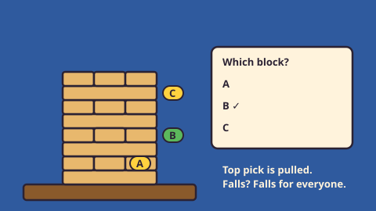

# Crowd Tower — game brief

> Every hour, everyone votes on which block to pull from one shared tower. If it falls, it falls for everyone.

**Rank:** Community idea · **Genre:** Community vote, stacking tower · **Art family:** Toybox Flat · **Audience habit:** Come back daily

@../../STANDARDS.md
@../../PHASES.md

## Why it works for Coolmath
A wooden block tower is instantly readable, and "will it stand?" is pure tension. One tower shared by thousands of players turns one small click into a shared event: you come back to see if it survived, and to beat the last tower's record. It is the first of the "CMG Community Features" ideas (turnaround review, October 2026, slide 4), where the community decides the actions.

Working title: the idea slide calls it "Crowd Jenga". Jenga is a Hasbro trademark, so the game uses "Crowd Tower" and never says "Jenga" in the game or its store text.

## Core loop
Open the game → watch the pulls since your last visit replay → vote on one of three blocks → the round closes, the top pick is pulled → the tower stands (block goes on top) or falls (a new tower starts, the record goes in the hall of fame) → come back later.

## Mechanics
- One tower for all players, 18 layers of 3 blocks, layers crossed like the real thing.
- Each round the game offers 3 candidate blocks (A, B, C). Players vote; the top pick is pulled when the round ends. Players can change their vote until the round closes.
- A pull either holds (the block goes on top) or makes the tower fall. The result comes from simple structure rules plus a seeded roll; the same rules run on the server and in the client.
- The record is the number of pulls the tower survived (and the days it lasted).
- Solo practice tower: the same rules, but you pick every pull, to learn how towers fall.

## Controls
Click or tap a candidate block (on the tower or in the vote panel) to vote. Keyboard: A / B / C or arrows + Enter.

## Progression and content (v1)
- The community tower, its vote panel, the "since your last visit" replay and the hall of fame of past towers.
- Solo practice tower with best score.

## Retention
Come back to see if the tower stood; vote streak; emoji result line; beat the last tower's record together.

## Art direction
Toybox Flat: warm wooden blocks with thick dark outlines on a deep blue stage, a wooden table, bright yellow and green vote accents. Candidate blocks carry big letter tags (A, B, C), never color alone.

### Concept art prompts
- **Gameplay screenshot (16:9):** *"Flat cartoon wooden block stacking tower seen in a 3/4 view on a wooden table, deep blue background, three blocks marked with letter tags A, B and C, a vote panel with bars on the right, thick dark outlines, soft shadows, 2D game screenshot, 16:9"*
- **Key art / thumbnail (16:9 and 1:1, no text):** *"a tall wobbly wooden block tower on a table, one block sliding out, many small cartoon hands pointing at it from below, deep blue background with soft spotlights, flat vector cartoon style, warm wood colors, thick dark outlines, soft drop shadows, toy-like and clean, room for a title, game key art"*
- **Logo:** *"the words "CROWD TOWER" built from stacked wooden blocks, one block half pulled out, flat vector cartoon style, thick dark outlines, soft drop shadows, plain background, bold and readable at small size"*
- **Negative prompt:** *"text, letters, watermark, signature, photorealistic, gritty, horror, violence, weapons, blood, cluttered background, blurry, low contrast, UI buttons"*

## Audio
Wood clack on pull, creak on wobble, soft thump when the block lands on top, comic clatter on collapse, crowd "ooh" on a close call.

## GameAnalytics
- Extra events: `vote:cast`, `vote:change`, `replay:seen:<n>`, `tower:fell:seen`.
- Question to answer: do players who vote come back the next day to see what happened?

## Scope
- **v1:** community tower with a stub backend that a Coolmath service can replace, solo practice tower, hall of fame.
- **Later:** special event towers, tower skins voted by the community.

## Risks and open questions
- Needs a server for votes and tower state. STANDARDS allows no network calls except GameAnalytics and the Coolmath SDK, so this depends on a Coolmath community service [confirm].
- Round length (hourly vs daily) changes the whole rhythm [confirm].
- With few voters, percentages feel empty; with many, griefing (voting the risky block on purpose) must not end towers too fast.

## Definition of done
`STANDARDS.md` checklist, plus: client and server agree on every pull result (same seed, same outcome); the headless simulator shows the tower lasts the target number of pulls.

## Vertical slice (phase 2)
The community screen against a local fake crowd (rounds sped up to 60 s): tower render, 3 candidates, vote panel, pull reveal, stand or fall, new tower, the replay of missed pulls, the full shell and GameAnalytics stubs.

## How to start
Don't start coding. Follow `../../PHASES.md` from phase 1: write and approve `GDD.md` first, then build the vertical slice above.
