# Daily Community Game — game brief

> Every day, everyone votes on which block to pull from one shared tower. The next day, everyone sees if it stood. If it falls, it falls for everyone.

**Rank:** Community idea · **Genre:** Community vote, stacking tower, **3D** · **Art family:** Toybox Flat · **Audience habit:** Come back daily

@../../STANDARDS.md
@../../PHASES.md

## Why it works for Coolmath
A wooden block tower is instantly readable, and "will it stand?" is pure tension. One tower shared by thousands of players turns one small click into a shared event: you come back to see if it survived, and to beat the last tower's record. It is the first of the "CMG Community Features" ideas (turnaround review, October 2026, slide 4), where the community decides the actions.

Name: **Daily Community Game** (renamed from Crowd Tower; the Jenga-style tower design is being rethought). The idea slide called it "Crowd Jenga"; Jenga is a Hasbro trademark, so the game never says "Jenga" in the game or its store text.

## Core loop
Open the game → watch the reveal of yesterday's pull (and any others you missed) → vote on one of three blocks → the round closes at midnight Pacific, the top pick is pulled → the tower stands (block goes on top) or falls (a new tower starts, the record goes in the hall of fame) → come back tomorrow.

## Mechanics
- One tower for all players, 18 layers of 3 blocks, layers crossed like the real thing.
- One round per day (24 hours, closing at midnight Pacific), so one pull per day.
- Each round the game offers 3 candidate blocks (A, B, C). Players vote; the top pick is pulled when the round ends. Players can change their vote until the round closes.
- A pull either holds (the block goes on top) or makes the tower fall. The result comes from simple structure rules plus a seeded roll; the same rules run on the server and in the client.
- **The collapse is the payoff.** It plays out with real 3D physics: the part above the pulled block tips as one piece, breaks apart on the table, and the blocks tumble, hit each other, pile up and fall off the edge. Physics only shows *how* the tower falls; the rules have already decided *that* it falls. Stand and fall start the same way (slide, wobble), so nobody knows until the end.
- The record is the number of pulls the tower survived (and the days it lasted).
- Solo practice tower: the same rules, but you pick every pull, to learn how towers fall.

## Controls
Click or tap a candidate block (on the tower or in the vote panel) to vote. Keyboard: A / B / C or arrows + Enter.

## Tech: this game is 3D
- **It must be 3D.** Rendering with **Three.js**, collapse physics with **cannon-es**, both bundled locally in the game folder (no CDN). STANDARDS.md allows Three.js when the brief asks for 3D; this brief does.
- Real 3D blocks seen through a fixed orthographic camera at a 3/4 angle (the tower reads like isometric art). The camera may zoom and move during a collapse.
- Physics runs only for the collapse (and optional small wobble effects), never to decide a result. The game rules (`tower.js`) stay plain JavaScript with no Three.js or cannon-es, so the server can run the same file.
- UI panels (vote, hall of fame) can be HTML/CSS over the 3D canvas.
- Performance: 60 fps on a school Chromebook during a full 54-block collapse with shadows on the table.

## Progression and content (v1)
- The community tower, its vote panel, the "since your last visit" replay and the hall of fame of past towers.
- Solo practice tower with best score.

## Retention
Come back to see if the tower stood; vote streak; emoji result line; beat the last tower's record together.

## Art direction
Toybox Flat in 3D: warm wooden blocks as real 3D boxes with flat, toy-like shading and thick dark outlines, on a deep blue stage and a wooden table with soft shadows, bright yellow and green vote accents. Candidate blocks carry big letter tags (A, B, C), never color alone. The collapse gets the full show: a short slow-motion beat at the break, the camera pulling back, dust, screen shake, then the fell panel with a **Watch again** button.

### Concept art prompts
- **Gameplay screenshot (16:9):** *"Flat cartoon wooden block stacking tower seen in a 3/4 view on a wooden table, deep blue background, three blocks marked with letter tags A, B and C, a vote panel with bars on the right, thick dark outlines, soft shadows, stylized 3D game screenshot, 16:9"*
- **Key art / thumbnail (16:9 and 1:1, no text):** *"a tall wobbly wooden block tower on a table, one block sliding out, many small cartoon hands pointing at it from below, deep blue background with soft spotlights, flat vector cartoon style, warm wood colors, thick dark outlines, soft drop shadows, toy-like and clean, room for a title, game key art"*
- **Logo:** *"the words "DAILY COMMUNITY GAME" built from stacked wooden blocks, one block half pulled out, flat vector cartoon style, thick dark outlines, soft drop shadows, plain background, bold and readable at small size"*
- **Negative prompt:** *"text, letters, watermark, signature, photorealistic, gritty, horror, violence, weapons, blood, cluttered background, blurry, low contrast, UI buttons"*

## Audio
Wood clack on pull, creak on wobble, soft thump when the block lands on top, comic clatter on collapse, crowd "ooh" on a close call.

## GameAnalytics
- Extra events: `vote:cast`, `vote:change`, `replay:seen:<n>`, `tower:fell:seen`.
- Question to answer: do players who vote come back the next day to see what happened?

## Scope
- **v1:** community tower with a stub backend that a Coolmath service can replace, solo practice tower, hall of fame.
- **Later:** special event towers, tower skins voted by the community.

## Risks and open questions
- Needs a server for votes and tower state. STANDARDS allows no network calls except GameAnalytics and the Coolmath SDK, so this depends on a Coolmath community service [confirm].
- Round length is daily (decided in the GDD). With one pull a day, the fall odds must be high enough that a tower lasts about two weeks, not months; the simulator must prove it.
- 3D on school Chromebooks: the 54-block physics collapse must hold 60 fps and stay within the size limit (Three.js + cannon-es are well under 2 MB). Prove it with a collapse prototype early.
- With few voters, percentages feel empty; with many, griefing (voting the risky block on purpose) must not end towers too fast.

## Definition of done
`STANDARDS.md` checklist, plus: client and server agree on every pull result (same seed, same outcome); the headless simulator shows the tower lasts the target number of pulls; a full collapse runs at 60 fps on a low-end Chromebook and is fun to watch again.

## Vertical slice (phase 2)
The community screen against a local fake crowd (rounds sped up to 60 s): 3D tower render, 3 candidates, vote panel, pull reveal, stand or the full 3D physics collapse, new tower, the replay of missed pulls, the full shell and GameAnalytics stubs.

## How to start
Don't start coding. Follow `../../PHASES.md` from phase 1: write and approve `GDD.md` first, then build the vertical slice above.
