# Dinosaur Game: HD Edition — game brief

> The offline browser dino, remastered: jump the cacti, duck the pterodactyls, grab coins, and race a friend on the same keyboard.

**Rank:** New idea · **Genre:** One-button endless runner, 1–2 players · **Art family:** HD Pixel (new, 16-bit SNES look) **[confirm]** · **Audience habit:** Coolmath nostalgia (everyone has played the no-internet dino)

@../../STANDARDS.md
@../../PHASES.md

## Why it works for Coolmath
Almost every player has already played the dinosaur game in Chrome when the internet was down, often at school. It needs no tutorial, a run lasts under a minute, and "one more try" comes by itself. The original is bare on purpose; this version keeps its exact feel and adds only the modern runner features that give a reason to come back: coins, skins, a daily run, and a 2-player race on one keyboard.

**Codename:** "Dinosaur Game: HD Edition". The original belongs to Google: the final name, the logo and the store text never say "Chrome", "Google" or "T-Rex Runner", and the dino and its sprites are original art, not traced from Chrome **[confirm final name]**.

## The design rule: no bloat
The first 10 seconds must feel exactly like the original: the same two inputs, the same speed curve, the same "you missed one jump and it's over". Every addition must pass this test: *does it change what a run feels like?* If yes, it is out of v1. Coins and skins are on top of the run, never inside it: no power-ups, no upgrades that change physics, no lives, no levels.

## Core loop
Title (the dino sleeps; any key wakes it) → run starts → jump and duck through obstacles as the speed rises, grab coins on the way → one hit ends the run → results: distance, coins, best → instant restart (under 1 s), or spend coins on a skin.

## Mechanics
- **Run:** the dino runs automatically. Speed starts slow and rises steadily up to a cap, like the original. Score is distance.
- **Jump:** tap to jump; hold for a higher jump (variable height, as in the original).
- **Duck:** hold down to duck under flying obstacles. Down in the air does a fast-fall.
- **Obstacles:** small and large cacti (single and in groups), and pterodactyls at three heights (jump, duck, or either). Obstacles are generated from a seed; gaps are always clearable at the current speed.
- **Coins:** placed in short arcs and lines, often on the riskier path (above a pterodactyl, over a tall cactus group). Coins never block or change the run. They are counted and banked at the end of the run.
- **Day and night:** the scene changes from day to night and back every few hundred meters, like the original, with a smooth color change.
- **Milestones:** a short flash and chime every 100 m.

## 2-player mode
- Two lanes stacked on one screen (P1 top, P2 bottom), both from the same seed, so both see the same obstacles at the same time.
- Both run at the same speed. When one crashes, their dino stays on screen as a ghost; the other keeps running. The last dino running wins; the score is the distance gap.
- A best-of-3 match is optional **[confirm]**. Coins earned in 2P go to the shared bank.

## Controls
- **1 player:** Space, Up or W to jump (hold for higher); Down or S to duck / fast-fall. Mouse/touch: tap to jump, hold the lower third of the screen to duck **[confirm]**.
- **2 players:** P1 W (jump) and S (duck); P2 Up (jump) and Down (duck). Touch: tap your half of the screen to jump; ducking in 2P on touch is open **[confirm]**.
- P to pause, R to restart.

## Shell (differs from STANDARDS)
An endless runner has no levels, so the level-select and star screens are replaced:
- **Title:** logo, **Play** (1P), **2 Players**, **Skins**, settings.
- **Skins:** a row of dinos with prices in coins; locked ones show as silhouettes. About 8 skins in v1 (for example: classic, robo-dino, dino in a hoodie, golden, ghost, lava, ice, pixel-original), all cosmetic **[confirm list]**. The characters from our game **Tag** (a work-for-hire project we own) are planned as crossover runners. They are redrawn in this game's art style from Tag's source art, and they keep the same hitbox as the dino.
- **Results:** distance and coins count up, best distance, **Retry** (big) / **Skins** / **Menu**.
- **Daily run:** one date-seeded run per day, same for everyone, with a streak and an emoji result line (STANDARDS daily challenge).

## Progression and content (v1)
- Endless 1P run, 2P race, daily run.
- About 8 skins bought with coins; a few unlocked by distance (first 1000 m) instead of coins.
- One desert scene with day and night.

## Retention
Best distance, daily run streak, saving up for the next skin, and the friend you just lost to sitting next to you.

## Art direction
**Open: two candidates, picked in the GDD [confirm].**
1. **HD Pixel (recommended):** a 16-bit SNES look. The dino is a chunky pixel sprite with more frames than the original (run, jump, duck, crash with a dizzy face), a few colors per sprite instead of one gray, parallax desert layers (dunes, mesas, clouds), and a warm sunset to deep blue night. Drawn in code or a small sprite sheet, Canvas 2D, stays well under 2 MB.
2. **Voxel 3D:** the same side-on game rendered as voxel models with a slightly tilted camera, soft shadows and depth. Needs Three.js bundled locally, costs more size and Chromebook performance, and more art time.

Either way: the dino reads instantly as "the dino" (big head, tiny arms), obstacles have strong silhouettes, coins spin and sparkle, and skins change color and shape, never the hitbox.

### Concept art prompts
- **Gameplay screenshot (16:9):** *"16-bit pixel art side-scrolling runner, a cute green pixel dinosaur with a big head and tiny arms jumping over a cactus in a desert, a line of spinning gold coins in an arc above the cactus, a pterodactyl flying ahead, parallax dunes and mesas, warm sunset sky, crisp SNES-style pixel art, 16:9 game screenshot"*
- **Key art / thumbnail (16:9 and 1:1, no text):** *"a cute pixel art dinosaur mid-jump over a cactus, gold coins flying around it, a second dinosaur in another color running below, desert at sunset turning to night with stars, crisp 16-bit SNES-style pixel art, saturated colors, room for a title, game key art"*
- **Character sheet:** *"pixel art dinosaur sprite sheet: run cycle, jump, duck, crash with dizzy eyes; plus skin variants (robot, hoodie, golden, lava, ice), 16-bit SNES style, consistent size, plain light background, evenly spaced"*
- **Logo:** *"the words "DINOSAUR GAME" in chunky pixel letters with a small "HD EDITION" banner, a pixel dinosaur head peeking over the letters, 16-bit pixel art, plain background, bold and readable at small size"*
- **Negative prompt:** *"text, letters, watermark, signature, photorealistic, gritty, horror, violence, blood, Google logo, Chrome logo, cluttered background, blurry, low contrast, UI buttons"*

## Audio
Jump "boop", duck swoosh, coin chime (pitch rises on a coin streak), 100 m milestone beep, crash thud. A short chiptune loop, off by default.

## GameAnalytics
- No levels, so progression events use one id per mode: `endless`, `versus`, `daily`, with the distance as score on `Fail`.
- Extra events: `run:death:<obstacle-type>`, `run:distance` (value), `coins:earned` (value), `skin:buy:<id>`, `skin:equip:<id>`, `versus:start`, `versus:winner:<p1|p2>`.
- Questions to answer: do coins and skins make runs per session go up compared with plain best-distance? How often is the 2P mode played, and are those sessions longer?

## Scope
- **v1:** 1P endless, 2P race, daily run, coins, about 8 skins, day/night, one desert scene.
- **Later (only if data says so):** more scenes (jungle, volcano, ice) that change every 1000 m, ghost of your best run, more skins. Not planned: power-ups, missions, upgrades, lives, loot boxes.

## Risks and open questions
- **Feel:** the original's jump arc, hitbox forgiveness and speed curve are what make it work. Measure them by playing the original side by side and match them before adding anything.
- **IP:** keep the name and art clearly original (see above); [confirm] with the team before any public build.
- **Tag crossover:** get Tag's source art (character sheets, colors) from the team, not from the live site. Decide in the GDD whether the Tag characters are unlocked with coins, by distance, or from the start, and whether Tag's style should steer the art direction.
- **2P on touch:** two players on one tablet with ducking may not work; 2P might be keyboard only.
- **Art style:** HD pixel vs voxel decides the tech (Canvas 2D or LittleJS vs Three.js). Decide in the GDD.
- **Coin placement:** coins must tempt, not distract. If players die chasing coins in the first 30 s, move them.

## Definition of done
`STANDARDS.md` checklist, plus: a player who knows the original says it "feels the same, but better" within one run; two players can start a race from the title in two clicks.

## Vertical slice (phase 2)
1P run with jump (variable height), duck and fast-fall; cacti and pterodactyls from a seed; speed ramp; coins; day/night; crash, results and instant restart; best distance saved; the title with the sleeping dino; GameAnalytics stubs. 2P and skins come in phase 3.

## How to start
Don't start coding. Follow `../../PHASES.md` from phase 1: write and approve `GDD.md` first, then build the vertical slice above.
