# Echo Steps — game brief

> Every attempt leaves an echo that replays what you did; solve each room by working together with your past selves.

**Rank:** #6 · **Genre:** Time-loop puzzle platformer · **Art family:** Night Neon · **Audience habit:** Play at the desk

@../../STANDARDS.md
@../../PHASES.md

## Why it works for Coolmath
A fresh, clever idea that feels like a brain-teaser and looks great in clips: three ghostly copies of yourself pressing buttons in sync. Short rooms suit a quick break.

## Core loop
Enter a room → try a route (up to 10 seconds) → the loop resets and an echo replays your last attempt → use echoes to hold buttons and doors while you go further → reach the exit → stars for using fewer echoes (1–3 minutes per room).

## Mechanics
- Each loop lasts a fixed time shown as a ring around the player. When it ends or you press Loop, an echo of that attempt is created.
- Up to 4 echoes per room; echoes replay exactly and interact with buttons, plates and switches, and can be stood on.
- Elements: pressure plates (door open while held), toggle switches, moving platforms, lasers that an echo can block, keys only the live player can carry.
- Clear an echo with Backspace (removes the latest).

## Controls
Arrows or WASD to move, Space or W/Up to jump, E or Enter to start a new loop early, Backspace to delete the last echo, R restart room.

## Progression and content (v1)
- 36 rooms in 3 worlds (Lab, Archive, Core), one new element each.

## Retention
Star chasing (fewest echoes), time attack per room, an unlockable "speed echo" cosmetic trail.

## Art direction
Night Neon: dark navy rooms, the player a bright cyan figure, echoes in fading violet with a trail, glowing plates and doors. Clean geometric shapes.
Concept prompt: *"Dark navy neon puzzle platformer room, a glowing cyan character and three fading violet ghost copies of itself standing on pressure plates holding doors open, glowing geometric platforms, minimal clean neon style, 2D side view game screenshot, 16:9"*

## Audio
Ticking loop timer, reverse-whoosh on reset, layered tones as each echo is created.

## GameAnalytics
- Extra events: `level:echoes_used` (value), `loop:early`, `echo:delete`.
- Question to answer: do players understand echoes by room 3, and where do they get stuck?

## Scope
- **v1:** 36 rooms, stars, time attack.
- **Later:** room editor.

## Risks and open questions
- Replays must be frame-exact: record inputs per fixed simulation step, not per rendered frame.
- The concept needs a very clear tutorial (rooms 1–3 teach one idea each).

## Definition of done
`STANDARDS.md` checklist, plus: two new players understand echoes without being told.

## Vertical slice (phase 2)
Platformer movement on a fixed-step simulation, the loop timer, recorded echoes that replay exactly, a pressure plate and door, 3 tutorial rooms, the full game shell and GameAnalytics stubs.

## How to start
Don't start coding. Follow `../../PHASES.md` from phase 1: write and approve `GDD.md` first, then build the vertical slice above.
