# Fire Brigade — game brief

> Pick a way in, chop through doors and hose down every fire before the building chars.

**Rank:** Prototype · **Genre:** Firefighting platformer · **Art family:** Night Pixel · **Audience habit:** Coolmath nostalgia (fans of two-players-one-keyboard co-op games)

@../../STANDARDS.md
@../../PHASES.md

## Why it works for Coolmath
A clear, kid-safe goal (put every fire out) that anyone gets in seconds. Spraying and chopping are automatic, so the skill is route planning: which way in, which fire first, when to go back for water. Two players on one keyboard, with real reasons to cooperate, fits the classic Coolmath co-op habit.

## Core loop
Pick a building and solo or 2P → choose a way in (front door, a window off the aerial ladder, or the roof) → move through a four-floor cross-section, chopping doors and debris → get near a fire and the hose sprays it → tank runs low, refill at the truck or a standpipe → fire keeps spreading sideways meanwhile → round ends when no fire is left (win) or the whole building is charred (loss). A run is a few minutes **[confirm typical length]**.

## Mechanics
As built in `game.js`:
- **Building:** side-on cross-section, 4 floors of rooms split by interior walls with open doorways or closed doors, ladders between floors, a roof hatch. Fire rooms and co-op spot positions are random each run; the floor plans are fixed per building.
- **Fire:** each burning cell gains heat over time and spreads sideways to neighbors through open doorways; closed doors burn through after a while. Fire never spreads up a floor, but a raging ledge can drip fire onto the floor below. Fires never burn out on their own. Burning chars the building; the integrity bar is the building's unburnt share.
- **Hose (automatic):** any fire within 6 tiles on your floor makes you spray (ahead while walking, either side while standing). Walls, doors and debris block the spray. Spraying drains the tank (100 water, 7 per second).
- **Axe (automatic):** walking into a door, window, hatch, skylight or debris pile chops it; each takes 2–4 hits.
- **Refill:** stand by the fire truck (fast) or a wall standpipe (slower, limited reserve that slowly refills). Each standpipe is walled in by debris you must chop first. Water-drop signs on the truck and pipes light up when someone is low; a dry pipe's sign goes grey.
- **Health:** standing in fire hurts. At zero you are knocked out for 3 s and respawn at the truck. Health regenerates out of the fire.
- **Ways in:** the aerial ladder always stands against the left wall from street to roof, with a landing at every upper-floor window. Choose the ground floor door, any upper window (chop it open), or the roof hatch. The mall adds a loading dock round the back and a roof skylight.
- **Ledges:** burning shelves 3 tiles up, higher than a solo jump. Solo gets 1–2 ledges with their ladder already down.
- **Co-op (2P only):** a partner's head is a one-way platform, so a stacked jump reaches higher. Each 2P run has 2–3 co-op spots on different floors: ledges (boost up, spray, pull the lever to drop a ladder) and steel barricades that can't be chopped (boost over, pull the lever on the far side to roll it up). Fire slowly leaks through barricades.
- **Shopping mall extras:** a central atrium that never burns, balconies, walkable escalator ramps between floors (one is broken and needs a co-op boost), stairwell ladders in the shop wings as the solo route, two starting fires per floor.

## Controls
Keyboard only today.
- **Solo:** WASD or arrows to move and climb; W, Up or Space to jump.
- **2P:** P1 WASD (W jumps), P2 arrows (Up jumps), one shared screen; the camera follows both and nobody can walk off screen.
- **Menus:** Left/Right picks the building, 1 or 2 starts solo or 2P; Up/Down and Enter/Space pick the way in; R, Space or Enter plays again; Esc goes back to the title.
- No mouse, touch, pause or restart-mid-round controls yet.

## Progression and content (what exists now)
- Two buildings, picked on the title screen: **Apartments** (62 columns wide, one starting fire per floor) and **Shopping Mall** (100 wide, atrium, two fires per floor). Upper floors start with bigger fires.
- Each run is randomized: which rooms burn, and where ledges and barricades go.
- End screen shows "ALL FIRES OUT!" or "THE BUILDING IS LOST", the percent of the building saved and the time.
- No levels list, stars, unlocks or saved progress.

## Retention
- **Exists:** random fire layout each run, choice of entry point, solo vs 2P, percent saved and time as an implicit score.
- **Ideas [confirm]:** stars from percent saved and time; best result saved per building and mode; more buildings as a level list; a daily seeded fire layout with a shareable "% saved" line.

## Art direction (current look)
Night Pixel: low-res pixel art rendered at 480×270 and scaled up without smoothing (1 world unit = 8 px). A 32-color palette shared with Vending Machine Sim. Night sky in dithered purple bands with a moon, stars and a two-layer distant skyline; street lamps. The building is a cut-away cross-section (This War of Mine style) with muted wallpapers (bright shop interiors in the mall) and procedural furniture. Firefighters are 16 px sprites with yellow helmets (P1 red coat, P2 blue). Animated pixel flames, smoke particles, rising embers, charring on the back walls, screen shake on chops and breaks, a blinking truck light bar. All sprites are text maps in code; no image files.

### Concept art prompts
Starting points for any image generator; the art direction above wins if they disagree. Paste each one whole.

- **Gameplay screenshot (16:9):** *"Pixel art side-view cross-section of a four-floor apartment building at night, rooms with furniture and wallpaper, small firefighters in yellow helmets and red coats spraying water arcs at pixel flames, smoke, a red fire truck with an aerial ladder against the left wall, dithered purple night sky with a moon and distant city skyline, crisp 16-bit retro game screenshot, 16:9"*
- **Key art / thumbnail (16:9 and 1:1, no text):** *"two cheerful pixel art firefighters, one in a red coat and one in a blue coat, yellow helmets, one standing on the other's shoulders spraying a bright water arc at flames in a cut-away building window, fire truck below, embers and smoke, dithered purple night sky with a moon, crisp limited-palette pixel art, warm orange fire against cool night blues, centered composition with room for a title, game key art"*
- **Character and element sheet:** *"pixel art game sprites on a plain background: firefighter idle, walking, climbing a ladder, chopping with an axe, knocked down; flames in three sizes, wooden door, window, debris pile, steel barricade, lever, wall standpipe with water-drop sign, roof hatch, fire truck, crisp limited-palette pixel art, evenly spaced, consistent scale"*
- **Logo (try several, keep the most readable):** *"the words "FIRE BRIGADE" in chunky pixel letters, orange and yellow with small pixel flames on top and a water drop dotting the I, crisp limited-palette pixel art, game logo on a plain dark background, bold and readable at small size"*
- **Negative prompt (generators that support it; drop "text, letters" for the logo):** *"text, letters, watermark, signature, photorealistic, gritty, horror, violence, injured people, blood, cluttered background, blurry, low contrast, extra limbs, UI buttons"*

## Audio
Synthesized ZzFX effects through the `SoundGenerator` helper in `templates/gameFx.js`: hose hiss, empty-tank click, axe chop, door/debris break, sizzle when a cell goes out, fire ignite, refill gurgle (pitch rises as the tank fills), hurt, lever, win and lose stings. Sounds are positional. No music, no mute toggle.

## GameAnalytics
Not integrated yet. When it is, besides the core events:
- Extra events: `entry:<ground|dock|floor2|floor3|floor4|roof>`, `player:down`, `coop:lever` (2P), `level:integrity` (percent saved, on Complete and Fail).
- Question to answer: which way in do players pick, and does it change how much of the building they save?

## Scope
- **v1 [confirm]:** the two existing buildings in solo and 2P, the full game shell, mouse and touch support for menus, saving and GameAnalytics per `STANDARDS.md`; tuning so a round has real time pressure.
- **Later:** more buildings, new hazards, a daily seeded layout.

## Risks and open questions
Gaps against `STANDARDS.md` and decisions for the GDD:
- **Engine and build:** uses LittleJS (`dist/littlejs.js`, about 650 KB unminified) plus `templates/gameFx.js`, against "no build step, no frameworks unless the brief says so". It runs from `index.html` without building, but has an optional npm build (`build.mjs`, terser + bestzip) that inlines everything into one zipped `index.html`. Decide: keep LittleJS (and say so in the GDD) or port. **[confirm]**
- **Folder layout:** `game.js` (about 2,600 lines) sits at the root, not in `src/`; extra files `dist/`, `templates/`, `build.mjs`, `package.json`, `.gitattributes`. `build.mjs` still mentions an `examples/` folder from the source repo.
- **Input:** keyboard only. Standards want mouse/trackpad first, touch through Pointer Events and 48 px targets. Movement-heavy 2P platforming may not map well to touch. **[confirm]**
- **Shell:** title doubles as level select (no worlds, no stars), no settings, no music/sound toggles, no pause or restart button in game, no level-complete stars or Next button.
- **Saving:** nothing is saved (`localStorage` unused).
- **Analytics and testing hook:** no GameAnalytics, no `window.game`.
- **Canvas:** fixed 480×270 scaled up by the engine; check it letterboxes cleanly from 800×450 to 1920×1080 and pauses on a hidden tab. **[confirm]**
- **Difficulty:** fires never burn out and the round is lost only when the building is fully charred, so failing is rare and slow. Decide a real fail condition or a star score. **[confirm]**
- **Look:** pixel art is not one of the three art families, and it uses a 32-color palette, not 4–6. Keep it as its own family or restyle. **[confirm]**
- **Text:** all on-screen text is small pixel-font uppercase; check readability at 800×450.
- **Content:** "knocked out" firefighters and burning buildings are cartoon-level, but check against Coolmath's kid-safe rules. **[confirm]**
- **Solvability:** fire rooms and co-op spots are random; every layout must be winnable in solo and in 2P.

## Definition of done
`STANDARDS.md` checklist, plus: every randomized layout of both buildings is winnable solo and in 2P; P1 and P2 are told apart by more than coat color.

## Prototype status
Began in the prototype-city repo and was moved here with its git history. It is playable now (`index.html`, two buildings, solo and 2P). There is no `GDD.md` yet; `meta.json` says `slice`, which describes the build but not a passed gate. **[confirm stage]**

## How to start
Next step is phase 1 of `../../PHASES.md`: write `GDD.md` that describes what is built and decides what changes (the gaps above), then get it Approved by a teammate. No new features before then.
