# Flip Runner — game brief

> An auto-runner where one tap flips gravity: run on the floor, flip to the ceiling, thread the gaps.

**Rank:** #2 · **Genre:** One-button skill runner · **Art family:** Chunky Cartoon · **Audience habit:** Coolmath nostalgia (fans of classic tunnel and gravity runners)

@../../STANDARDS.md
@../../PHASES.md

## Why it works for Coolmath
One-button runners are a Coolmath staple: instantly understood, endlessly retried. Gravity flipping adds a fresh, readable twist and makes every death feel like "one more try".

## Core loop
Level starts → character runs automatically → tap to flip between floor and ceiling to dodge gaps and spikes and grab stars → reach the goal or fall → instant restart from the last checkpoint (levels 20–60 seconds).

## Mechanics
- Constant forward speed per level; a tap flips gravity (a short, readable arc, not instant).
- Flip is allowed only when touching a surface (no mid-air flip), so timing matters.
- Obstacles: gaps, spikes, moving blocks, gravity-locked zones (no flipping), speed pads, portals that swap to a parallel lane.
- Checkpoint flags every ~15 seconds; death restarts at the last flag in under 0.5 s.
- Stars: 3 per level, placed on the risky route.

## Controls
Space, Up/Down, click or tap anywhere to flip. P to pause.

## Progression and content (v1)
- 40 levels in 4 worlds (Lab, Caves, Sky Factory, Space Station), one new obstacle per world.
- Endless mode unlocked after world 1: procedurally chained chunks, distance high score.

## Retention
Daily endless seed (same run for everyone that day, emoji result line), character skins bought with stars, death counter shown proudly on the results screen.

## Art direction
A round, determined little character with a trailing scarf that shows the gravity direction. Flip animation squashes and stretches. Each world has a distinct palette; floor and ceiling clearly different shades.

### Concept art prompts
Starting points for any image generator; the art direction above wins if they disagree. Paste each one whole.

- **Gameplay screenshot (16:9):** *"Cute round cartoon character running upside down on the ceiling of a colorful lab corridor, gravity flip motion trail, spikes and gaps below, bright chunky cartoon style, thick outlines, 2D side-scrolling game screenshot, 16:9"*
- **Key art / thumbnail (16:9 and 1:1, no text):** *"a round determined little character with a long trailing scarf flipping in mid-air between floor and ceiling of a colorful corridor, motion arc showing the flip, spikes below, sense of speed, chunky cartoon style, round squishy shapes, big expressive eyes, saturated colors, thick dark outlines, soft cel shading, playful squash-and-stretch energy, centered composition with room for a title, game key art"*
- **Character and element sheet:** *"the round runner character with scarf: running, flipping, upside-down running on the ceiling, landing squash, and a fall; plus spikes, gaps, checkpoint flag and star, chunky cartoon style, round squishy shapes, big expressive eyes, saturated colors, thick dark outlines, soft cel shading, playful squash-and-stretch energy, game asset sheet on a plain light background, evenly spaced, consistent scale"*
- **Logo (try several, keep the most readable):** *"the words "FLIP RUNNER" in bold rounded letters, with the word RUNNER flipped upside down like a mirror, a curved arrow showing a gravity flip, chunky cartoon style, round squishy shapes, big expressive eyes, saturated colors, thick dark outlines, soft cel shading, playful squash-and-stretch energy, game logo on a plain background, bold and readable at small size"*
- **Negative prompt (generators that support it; drop "text, letters" for the logo):** *"text, letters, watermark, signature, photorealistic, gritty, horror, violence, weapons, blood, cluttered background, blurry, low contrast, extra limbs, UI buttons"*

## Audio
A short "whoop" on every flip (pitch rises with consecutive quick flips), crunchy death sound, star pickup chime.

## GameAnalytics
- Extra events: `death:<obstacle-type>`, `checkpoint:<n>`, `endless:distance` (on run end, with value).
- Question to answer: which obstacle causes the most quits, and how many retries does a level take before players finish or leave?

## Scope
- **v1:** 40 levels, endless mode, daily seed, skins.
- **Later:** level editor, ghost of your best run.

## Risks and open questions
- Input latency is everything: process the flip on pointer down / key down, not on release.
- Difficulty spikes kill runners: playtest the first 10 levels with someone new.

## Definition of done
`STANDARDS.md` checklist, plus: a new player clears level 1 on the first or second try.

## Vertical slice (phase 2)
The runner with gravity flip, checkpoints, gaps and spikes, one complete level, instant restart, the full game shell and GameAnalytics stubs.

## How to start
Don't start coding. Follow `../../PHASES.md` from phase 1: write and approve `GDD.md` first, then build the vertical slice above.
