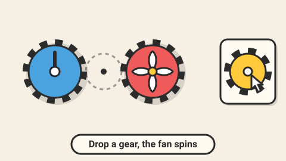

# Gear Works — game brief

> Place gears on the pegs so the last one turns the right way at the right speed.

**Rank:** #11 · **Genre:** Mechanical logic puzzle · **Art family:** Toybox Flat · **Audience habit:** Play at the desk

@../../STANDARDS.md
@../../PHASES.md

## Why it works for Coolmath
Gears are tactile and quietly mathematical (direction alternates, size changes speed), a perfect fit for Coolmath's brand. Watching the whole machine spin up is deeply satisfying.

## Core loop
See the motor and the target machine → place gears from the tray on pegs → gears mesh with neighbors → press Run → the target turns the right way at the right speed or not → stars for fewest gears (1–3 minutes per level).

## Mechanics
- Pegs on a board; gears come in sizes small, medium and large. Gears placed on adjacent pegs mesh when their radii touch.
- Meshing gears turn in opposite directions; speed ratio follows the size ratio.
- Goal: the target (a music box, a fan, a clock hand) must turn clockwise or counter-clockwise at the shown speed (slow, normal, fast).
- Jams: a closed loop of an odd number of gears locks up (shown clearly).
- Later elements: shared axles (two gears on one peg turn together), chains and belts, fixed gears, two targets with different needs.

## Controls
Drag gears from the tray onto pegs, drag off to remove. Touch the same. Keyboard: arrows move cursor, 1–3 pick size, Space place, Enter run. Z undo.

## Progression and content (v1)
- 50 levels in 4 workshops (Clocks, Toys, Windmills, Robots).

## Retention
Fewest-gear stars, a machine gallery that fills with every target you have powered, daily gear puzzle with streak.

## Art direction
Toybox Flat: brass and wood workshop, chunky gears with clear teeth, each size a different color plus size label, targets as cute machines that come alive when powered.
Concept prompt: *"Flat cartoon gear puzzle game, chunky brass and colorful gears meshing on a wooden pegboard, a cute music box machine coming alive when the gears turn, workshop background, warm light colors, thick outlines, soft shadows, 2D game screenshot, 16:9"*

## Audio
Satisfying click when a gear meshes, ticking while running at speed-matched tempo, machine jingle on success, grinding on jam.

## GameAnalytics
- Extra events: `level:gears_used` (value), `level:jam`, `run:wrong_direction`, `run:wrong_speed`.
- Question to answer: which concept (direction, speed, axle) causes the most failed runs?

## Scope
- **v1:** 50 levels, gallery, daily, editor (debug).
- **Later:** belts and chains world, sandbox.

## Risks and open questions
- Pure logic, no physics needed: compute direction and speed with a graph traversal; detect odd loops as jams.

## Definition of done
`STANDARDS.md` checklist, plus: solver confirms the minimum gear count for every level.

## Vertical slice (phase 2)
Pegboard, three gear sizes, drag to place, meshing graph with direction and speed, jam detection, a target machine, Run, 3 tutorial levels, the full game shell and GameAnalytics stubs.

## How to start
Don't start coding. Follow `../../PHASES.md` from phase 1: write and approve `GDD.md` first, then build the vertical slice above.
