# Hop Race — game brief

> Two players, one key each: hold to charge, release to hop, first to the flag wins.

**Rank:** Prototype · **Genre:** One-button race · **Art family:** Two-tone Minimal · **Audience habit:** Coolmath nostalgia (fans of two-players-one-keyboard games)

@../../STANDARDS.md
@../../PHASES.md

## Why it works for Coolmath
Each player has exactly one key, so anyone can pick it up in seconds and two kids can share one keyboard. Timing the charge and the sweeping aim is the whole skill, and a race is over in under a minute, so "one more" comes easily. The game is a set of modes that each give the one button a different meaning (hop, rocket, grappling hook, turn to sand), which keeps it fresh.

## Core loop
Pick a mode on the menu → both players start side by side on the left → hold your key to charge, release to act → cross pits and walls to the flag on the right → the first player to finish wins the round and gets a point → press A or L to race again, M for the menu. A round lasts about 20–60 s **[confirm]**.

## Mechanics
As built in `game.js`. P1 holds `A`, P2 holds `L`. Falling below the screen puts you back where you last stood.
- **Classic:** you move only by jumping. While you hold, power charges (full in 1.1 s) and the aim angle sweeps up and down between 18° and 80°; a dotted arc and an arrow show the jump. Release to jump. Walls bounce you back. Land grounded past the flag line to win.
- **Wall Jump:** same hop, but hitting a wall mid-air makes you cling, slide slowly down, and turn away from it; charge and jump off again. One hanging wall to duck under, one tall wall to climb by zigzagging.
- **Rocket Jump:** a launcher spins around you all the time. Press to fire a rocket; its blast shoves anyone nearby away from it (including you), and each shot reverses the spin (the prototype; the current game always spins clockwise, GDD §3.3). Shoot the red ceiling button to lift a gate, then drop down the shaft to the flag. Rockets also knock the other player around.
- **Grappling Hook:** the same spinning launcher fires a hook. Press to fire, hold to reel in toward where it stuck, release to cut loose and keep your speed. Pillars hang from the ceiling over a pit.
- **Flow:** you are a square of 49 sand grains on tilted slabs. Hold to crumble into sand that pours downhill; release to pack the grains back into a (smaller) square. Grains that fall off are lost; under 12 left and you respawn. At least 40 grains must touch the flag to win.
- **Flow 2:** the flag hangs from a sloping ceiling. Drop into the fire pit as sand to turn into gas that rises and slides up the ceiling to it. Press while gas to condense and fall as sand; let go to condense through liquid back into a solid square.
- **Hidden modes:** *Rocket Jump (pits)* and *Orbit* (concentric rings with rotating exits; hidden because it was dizzying) are still in the code with `hidden: true`.

## Controls
Keyboard only today.
- **In a race:** P1 `A`, P2 `L`. Hold or press depends on the mode (shown under each player's score).
- **Menu:** Up/Down and Enter, Space, A or L to start; number keys jump straight to a mode. `M` returns to the menu from anywhere; A, L or Space races again after a win.
- No mouse, touch, pause, settings or solo mode.

## Progression and content (what exists now)
- Six modes in the menu, each one fixed level: Classic, Wall Jump, Rocket Jump, Grappling Hook, Flow, Flow 2.
- A win counter per player for the session. No levels list, stars, unlocks or saved progress.

## Retention
- **Exists:** quick rematches, a running score between two players, several modes that reinterpret the one button.
- **Ideas [confirm]:** several levels per mode; a solo mode against a ghost or a timer with stars; best times saved per level; best-of-N matches.

## Art direction (current look)
Close to Night Neon: dark navy-purple background with faint stars, dark purple platforms with a cyan top edge. Players are flat squares with a light inner square and a black eye (P1 blue, P2 orange) plus a fading trail and squash-and-stretch. Yellow pennant flag with a checker line. Dotted aim arcs, power bars, particle puffs on landing, explosion rings and screen shake for rockets, sand/gas/liquid grains drawn as circles in Flow. Everything is drawn with engine primitives; no image files.

## Audio
Synthesized ZzFX effects through `SoundGenerator` in `templates/gameFx.js`: jump, land, fall, charge ticks (pitch rises with power), rocket fire, explosion, win jingle. No music, no mute toggle.

## GameAnalytics
Not integrated yet. When it is, besides the core events:
- Extra events: `mode:<name>` on start, `race:winner` (P1/P2) with round time, `player:respawn` per mode.
- Question to answer: which modes do pairs play most, and how long does a round take in each?

## Scope
- **v1 [confirm]:** pick which modes ship (keep, cut or merge), a few levels per mode, the full game shell, saving and GameAnalytics per `STANDARDS.md`, and a decision on solo play.
- **Later:** more modes built on the same one-button idea.

## Risks and open questions
Gaps against `STANDARDS.md` and decisions for the GDD:
- **Two players only:** there is no solo mode or AI. Many Coolmath players are alone at the desk. **[confirm]**
- **Engine and build:** LittleJS (`dist/littlejs.js`, about 650 KB unminified) plus `templates/gameFx.js`, against "no build step, no frameworks unless the brief says so". It runs from `index.html` without building; `build.mjs` is an optional minify-and-zip step. Keep LittleJS (and say so in the GDD) or port. **[confirm]**
- **Input:** keyboard only, with P1 and P2 on fixed keys. Standards want mouse/trackpad first and touch through Pointer Events; two-player one-button could map to the two halves of a touch screen. **[confirm]**
- **Shell:** the menu is a mode list; no title, settings, sound toggles, pause, restart button, stars or Next button.
- **Saving and testing hook:** nothing is saved; no GameAnalytics; no `window.game`.
- **Debug leftovers:** `RC_SAND.debug` is on, so grain counts show above players in Flow.
- **Focus:** six very different modes is a lot for one game. Decide whether Hop Race is one mode done deep or a party pack. **[confirm]**
- **Canvas:** world view is 42×23 units scaled to fit; check letterboxing from 800×450 to 1920×1080 and pausing on a hidden tab. **[confirm]**
- **Fairness:** P2 starts 1.4 units to the right of P1 on the same ground; check no mode gives one side an edge.

## Definition of done
`STANDARDS.md` checklist, plus: every shipped level is winnable in each mode by both players; P1 and P2 are told apart by more than color.

## Working on the code
- **Run:** open `index.html` directly, or serve the folder (`python3 -m http.server`) and load `http://localhost:8000`. Prefer HTTP when driving it from an agent browser; `file://` previews can render only a static snapshot.
- **Syntax check:** `for f in src/*.js src/modes/*.js levels/*.js; do node --check $f; done` (there is no test suite or linter).
- **Release zip (only when shipping):** copy `littlejs.release.js` from the LittleJS plugin's `dist/` into `./dist/`, then `npm install && npm run build`. Output is `build/index.html` plus `hopRace.zip` (both gitignored). Confirm the build log says it used the release engine, not the debug one. `build.json` lists the sources in the same order as `index.html`; keep the two in sync.
- **Layout:** classic scripts (not ES modules, so `file://` works), loaded in order by `index.html`. All globals are prefixed `hr` / `HR_` to avoid colliding with LittleJS globals.
  - `src/config.js` palette, `HR_WORLDS`, `HR_LEVELS`, `isUnlocked()` · `src/save.js` · `src/analytics.js` (console stubs) · `src/audio.js` · `src/input.js` · `src/camera.js` · `src/level.js` · `src/player.js` · `src/ghost.js` · `src/render.js` · `src/ui.js` · `src/main.js`
  - `src/modes/<world>.js` adds `HR_MODES.<world> = {reset(p), step(p, input), draw(p)}`. Input is `{down, pressed, released}`; modes never read devices.
  - `levels/<world>.js` adds `HR_LEVELS.<world> = [...]` in the GDD §6 format.
- **State machine:** `hrScreen` is `title | modes | levels | settings | playing | paused | complete | round | match`. `hrStartLevel(world, index, versus)` loads and starts a level. Each screen lists its buttons in `hrUiButtons()`, which drives hit tests, keyboard focus and drawing.
- **Testing hook:** `window.game` (`screen`, `level`, `mode`, `versus`, `score`, `start(levelId, versus)`, `restart()`, `win()`). For frame-exact tests, set `hrGo('title')` so the engine stops stepping players, then call `hrPlayerStep(p, {down, pressed, released})` yourself.
- **Prototype:** `prototype/index.html` + `prototype/game.js` is the original six-mode game, kept as the tuning reference until Rocket, Grapple and Phase are ported (phase 3). Don't add features to it. The Hop port matched it frame for frame (Classic and Wall Jump levels at size 42, same inputs).
- **Vendored:** `dist/littlejs.js`, `build.mjs` and `templates/` come from the LittleJS plugin (`linguist-vendored` in `.gitattributes`). Don't edit or review them.
- **LittleJS gotchas:** circle/ellipse sizes are diameters, `ParticleEmitter` speed is per frame, `Color.scale(scale, alphaScale)` scales alpha separately; `keyIsDown`/`keyWasPressed` take `KeyboardEvent.code` strings (`'KeyA'`). WebGL is off (`setGLEnable(false)`) so world, HUD and menus draw in call order on one 2D canvas; screen-space polygons are y up while screen-space rects and text are y down.

## Prototype status
Began in its own repo (onebutton-twoplayer-game) and was moved here with its git history. The prototype is playable from `prototype/index.html`. `GDD.md` is Approved (2026-10-21) and is the source of truth for the design; the sections above describe the prototype as it was built.

## How to start
Phase 2 (vertical slice) of `../../PHASES.md`: Hop levels 1–3 with the full shell, as `GDD.md` §13 describes. Check `DEVLOG.md` for where it stands.
