# Ice Slide — game brief

> A penguin slides across the ice until it hits something; push every fish into a hole in as few moves as possible.

**Rank:** #4 · **Genre:** Sliding-block puzzle · **Art family:** Chunky Cartoon · **Audience habit:** Daily puzzle

@../../STANDARDS.md
@../../PHASES.md

## Why it works for Coolmath
Ice-sliding puzzles are simple to read and surprisingly deep. A charming penguin gives it personality, and "solve it in N moves" makes a perfect daily puzzle.

## Core loop
Look at the frozen board → choose a direction → penguin slides until it hits a rock, wall or fish → fish get pushed and slide too → drop every fish into a hole → stars for fewest moves (1–3 minutes per level).

## Mechanics
- Grid board. Penguin moves in 4 directions and slides until blocked.
- Fish slide when pushed, also until blocked; a fish falls into a hole and fills it.
- Later elements: snow tiles (stop sliding), cracked ice (breaks after one pass), arrows (force direction), seals (block, move when bumped).
- Undo unlimited, restart instant. Move counter on screen, par shown.

## Controls
Arrows or WASD; swipe on touch; click a direction arrow around the penguin with the mouse. Z undo, R restart.

## Progression and content (v1)
- 60 levels in 4 worlds (Pond, Glacier, Cave, Aurora). One new element per world.
- Debug level editor exporting JSON.

## Retention
Daily puzzle with par moves, streak and emoji line. Penguin hats unlocked by stars.

## Art direction
Chunky cartoon penguin with a scarf, wobbly squash on impact, fish that flap when pushed. Icy blues with warm accents so it does not feel cold. Clear grid lines faintly etched into the ice.

### Concept art prompts
Starting points for any image generator; the art direction above wins if they disagree. Paste each one whole.

- **Gameplay screenshot (16:9):** *"Cute chunky cartoon penguin with a red scarf sliding on an icy puzzle grid, pushing colorful fish towards holes in the ice, rocks and snow tiles, bright saturated colors, thick outlines, top-down 2D puzzle game screenshot, 16:9"*
- **Key art / thumbnail (16:9 and 1:1, no text):** *"a cute chunky penguin with a red scarf sliding happily across shiny ice, pushing a surprised colorful fish towards a hole in the ice, splash and sparkle, cozy icy blues with warm accents, chunky cartoon style, round squishy shapes, big expressive eyes, saturated colors, thick dark outlines, soft cel shading, playful squash-and-stretch energy, centered composition with room for a title, game key art"*
- **Character and element sheet:** *"the penguin with red scarf: idle, sliding, bump squash, celebrating; plus fish in several colors with shape markings, ice hole, rock, snow tile and cracked ice tile, chunky cartoon style, round squishy shapes, big expressive eyes, saturated colors, thick dark outlines, soft cel shading, playful squash-and-stretch energy, game asset sheet on a plain light background, evenly spaced, consistent scale"*
- **Logo (try several, keep the most readable):** *"the words "ICE SLIDE" in chunky icy letters with a little snow on top, a penguin sliding along the baseline leaving a streak, chunky cartoon style, round squishy shapes, big expressive eyes, saturated colors, thick dark outlines, soft cel shading, playful squash-and-stretch energy, game logo on a plain background, bold and readable at small size"*
- **Negative prompt (generators that support it; drop "text, letters" for the logo):** *"text, letters, watermark, signature, photorealistic, gritty, horror, violence, weapons, blood, cluttered background, blurry, low contrast, extra limbs, UI buttons"*

## Audio
Ice "shhh" slide, soft bonk on rocks, splash and cheer when a fish drops in.

## GameAnalytics
- Extra events: `level:moves` (value), `level:par_met`, `ui:undo`.
- Question to answer: how many undos before solving, and which mechanic raises drop-off?

## Scope
- **v1:** 60 levels, daily, hats, editor (debug).
- **Later:** two-penguin levels.

## Risks and open questions
- Needs a BFS solver to verify solvability and compute par for every level and daily.

## Definition of done
`STANDARDS.md` checklist, plus: solver verifies par for every level.

## Vertical slice (phase 2)
Grid, sliding penguin, pushable fish, holes, rocks, move counter, undo, 3 tutorial levels, the full game shell and GameAnalytics stubs.

## How to start
Don't start coding. Follow `../../PHASES.md` from phase 1: write and approve `GDD.md` first, then build the vertical slice above.
