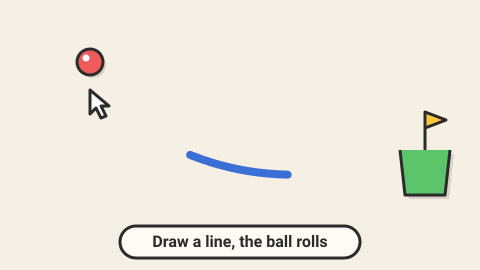

# Ink Path — game brief

> Draw one line with a limited pot of ink; when you let go, the ball rolls and must reach the goal.

**Rank:** #9 · **Genre:** Physics drawing puzzle · **Art family:** Toybox Flat · **Audience habit:** Play at the desk

@../../STANDARDS.md
@../../PHASES.md

## Why it works for Coolmath
Draw-a-line puzzles have many valid answers, so every player feels clever in their own way. Easy to start with a mouse or trackpad, endlessly replayable for 3 stars.

## Core loop
See the ball, the goal and the obstacles → draw one line → release → physics plays out → ball reaches the goal or falls → retry instantly → stars for using little ink (30 seconds–2 minutes per level).

## Mechanics
- One stroke per attempt; the line becomes a solid static body when released, then the ball drops.
- Ink meter limits the stroke length; stars for staying under ink targets.
- Elements: walls, gaps, bouncy pads, moving platforms, no-draw zones, fans, buttons that open gates, two balls that must both arrive.
- Optional stars on the level that the ball must touch for 3 stars.

## Controls
Mouse or trackpad: press and drag to draw. Touch: finger drag. R or a button to retry, Z to undo the line before release (if the ball has not dropped yet).

## Progression and content (v1)
- 50 levels in 4 worlds (Notebook, Kitchen, Garden, Space).

## Retention
Ink-saving records per level, a replay of your best solution, pen colors and line styles unlocked with stars.

## Art direction
Toybox Flat with a paper-craft feel: lined-paper or cardboard backgrounds, thick hand-drawn ink line with a slight wobble, a shiny cartoon ball with a face. Bright, clean, readable.
Concept prompt: *"Flat cartoon physics drawing puzzle, a thick hand-drawn ink line guiding a cute shiny ball with a face towards a goal cup, paper craft notebook background, bouncy pads and walls, warm light colors, thick outlines, 2D game screenshot, 16:9"*

## Audio
Pen scratch while drawing, soft rolling, boing on pads, applause on goal.

## GameAnalytics
- Extra events: `level:ink_used` (percent), `level:attempts` (value).
- Question to answer: how many attempts per level, and do players replay for ink stars?

## Scope
- **v1:** 50 levels, ink stars, replays, cosmetics.
- **Later:** level editor with share codes.

## Risks and open questions
- Use a small, well-tested 2D physics approach (circle vs polyline collision, fixed step). Simplify the drawn stroke (Ramer–Douglas–Peucker) to keep collisions cheap.
- Determinism so a solution replays the same.

## Definition of done
`STANDARDS.md` checklist, plus: each level has a recorded reference solution that passes.

## Vertical slice (phase 2)
Stroke drawing with an ink meter, line to static body, ball physics on a fixed step, goal detection, instant retry, 3 tutorial levels, the full game shell and GameAnalytics stubs.

## How to start
Don't start coding. Follow `../../PHASES.md` from phase 1: write and approve `GDD.md` first, then build the vertical slice above.
