# Jumping Jeepney — game brief

> Jump canals and drop each rider on the rooftop stop that matches their shirt.

**Rank:** Prototype · **Genre:** Endless runner · **Art family:** Chunky Pixel · **Audience habit:** Coolmath nostalgia

@../../STANDARDS.md
@../../PHASES.md

## Why it works for Coolmath
A one-button runner, the kind Coolmath players already know, with a small routing decision on top: every rider wants a different stop, so each jump is "where do I land?", not only "when do I jump?". Runs are short, restart is one press, and it plays with the sound off in a small tab.

## Core loop
Press to drive → the jeepney speeds up on its own → jump canals and power lines → drive into waving riders to pick them up → read the shirt color → land on the rooftop stop with that color → collect the fare → miss a stop and the rider bails → fall into a canal and the run ends → see fares and distance → press to drive again. A run lasts about 1–3 minutes **[confirm with playtests]**.

## Mechanics
As built in `game.js`:
- **Auto-run:** the jeepney always drives right. Speed rises from 10 to 18 units/s over the first 3000 m (1 unit = 1 m on the HUD).
- **Jump:** one button. Press to jump, press again in the air to double jump (a higher boost). Holding makes the jump higher; letting go early cuts it short. Driving off a ledge keeps both jumps. Boosters under the chassis shoot flames on each jump.
- **One-way platforms:** rooftops, floating billboards and the elevated LRT deck. The jeepney jumps up through them and lands on top. Buildings stand behind the road, so it drives in front of them.
- **Riders:** people wait and wave on the road, on roofs and on the LRT deck. When they come near the screen they pick one of the next 3 stops, and their shirt turns that stop's color (gray until then). Drive into them to board. 8 seats; a full jeepney shows "FULL!".
- **Stops:** 6 named stops (Binondo, Divisoria, Quiapo, Luneta, Ermita, Malate), each with its own color (red, orange, yellow, green, cyan, purple). A stop is a rooftop with a striped parapet, a waiting shed and a sign. One every 30–50 m. Land on it and every rider for that stop gets off. Fare is $10 + $2 per unit of roof height, so high stops pay more.
- **Stop hints:** a rider calls "PARA PO!" from the window when their stop is 14 m ahead; an arrow bounces over the stop sign; stops off screen get a colored marker at the screen edge.
- **Missed stops:** drive past a stop and its riders bail out ("MISSED <STOP>"), fare lost.
- **Canals:** gaps in the road, 3–10 wide (wider later). Fall in and the run is over ("SPLASH!"). Wide canals can have a billboard to step on; some LRT stretches have a canal under the tracks.
- **High stops:** from 25% to 60% of stops sit high up, with a billboard halfway to step from.
- **Power lines (from 150 m):** sagging live wires between wooden posts. Over the road: drive under them or double jump the posts. Between rooftops: hop over. A zap knocks the jeepney down, removes its jumps, makes one random rider bail, and gives 1.5 s of blinking grace. It does not end the run.
- **Difficulty ramp:** over 3000 m, speed, canal width, power-line frequency and the share of high stops all rise. The first 55 m are a calm stretch with two easy pickups.
- **World:** generated left to right from random pieces (flat road, building blocks, canals, LRT deck, power lines, stops). No seed, so every run is different.

## Controls
One button: Space, Up arrow, W, left click, tap, or gamepad button A. Press to jump, press again in the air to double jump, hold for height. The same button starts a run and restarts after game over. No pause, restart or mute keys yet.

## Progression and content (what exists now)
- One endless mode. No levels, worlds, stars or level select.
- Title screen (logo, three lines of how to play, best score, "PRESS TO DRIVE") and a game-over panel (fares, distance, riders delivered, best).
- HUD: fares top left, distance top right, 8 seat boxes in the riders' stop colors at the top center.
- Missed riders are counted in code but not shown anywhere.

## Retention
- **Exists:** best fares and best distance, saved locally and shown on the title and game-over screens.
- **Ideas [confirm]:** daily run on a date-seeded world with a streak and an emoji result line; short goals per run ("deliver 5 to Quiapo"); unlockable jeepney paint jobs from total fares; a delivered/missed ratio on the results screen.

## Art direction (current look)
Chunky pixel art: renders at 240×135 and scales up with no smoothing, 8 pixels per world unit. Every pixel is fully opaque: no alpha, no antialiasing, no fades (things blink out instead). Sprites are drawn in code from text maps with a 1-pixel dark outline. A fixed palette of about 27 colors (STANDARDS asks for 4–6).

Sunny Manila street: banded blue sky, a pixel sun and clouds, two parallax skyline layers, rooftops in mixed colors with windows, shutters and water tanks, palm trees and street lamps, the LRT deck on pillars, a brick canal wall with blue water. The jeepney is white, red, blue and yellow with a long hood. Billboards show made-up food brands (HALO HALO!, PANCIT KING, SIOPAO EXPRESS…) with pixel food on a sunburst. Text uses a 3×5 pixel font.

### Concept art prompts
Starting points for any image generator; the art direction above wins if they disagree. Paste each one whole.

- **Gameplay screenshot (16:9):** *"Side-scrolling pixel art endless runner, a colorful Filipino jeepney with rocket boosters jumping over a canal onto a rooftop bus stop, passengers in bright colored shirts waving, sunny Manila street with rooftops, palm trees, elevated train track and food billboards, chunky low-resolution pixel art, crisp 1-pixel dark outlines, no anti-aliasing, bright sunny palette, 2D game screenshot, 16:9"*
- **Key art / thumbnail (16:9 and 1:1, no text):** *"a colorful Filipino jeepney mid-jump with booster flames under it, flying over a canal toward a rooftop stop, happy passengers waving from its windows, sunny city skyline with palm trees and billboards behind, chunky low-resolution pixel art, crisp 1-pixel dark outlines, no anti-aliasing, bright sunny palette, playful and clean, centered composition with room for a title, game key art"*
- **Character and element sheet:** *"game pieces: a colorful jeepney side view, the jeepney with booster flames, passengers waving and cheering in red, orange, yellow, green, cyan and purple shirts, rooftop bus stop with waiting shed and sign, floating food billboard, elevated train deck, power line post with sagging wire, canal water tile, chunky low-resolution pixel art, crisp 1-pixel dark outlines, no anti-aliasing, bright sunny palette, game asset sheet on a plain light background, evenly spaced, consistent scale"*
- **Logo (try several, keep the most readable):** *"the words "JUMPING JEEPNEY" in chunky pixel letters, yellow and red, a small jeepney jumping over the letters with booster flames, chunky low-resolution pixel art, crisp 1-pixel dark outlines, no anti-aliasing, bright sunny palette, game logo on a plain background, bold and readable at small size"*
- **Negative prompt (generators that support it; drop "text, letters" for the logo):** *"text, letters, watermark, signature, photorealistic, smooth gradients, anti-aliasing, 3D render, gritty, horror, violence, weapons, blood, cluttered background, blurry, low contrast, extra limbs, UI buttons"*

## Audio
Small synthesized effects (ZzFX through the `SoundGenerator` helper in `templates/gameFx.js`): a two-tone horn when a run starts, jump and higher double-jump whooshes, a landing thud on hard landings, a ping when a rider boards, a rising jingle on drop-off, a falling tone on a missed stop, a dull buzz when full, a crackle on a zap, a splash on game over. No music. No mute toggle.

## GameAnalytics
Nothing is wired yet. Proposal:
- Core: progression `Start` / `Fail` per run (id `endless`), score = fares on `Fail` **[confirm how an endless run maps to Start/Complete/Fail]**.
- Extra events: `run:distance` (value), `run:delivered` and `run:missed` (values), `hazard:zap`, `death:canal` with the distance band.
- Question to answer: what ends runs, and at what distance? Do players understand the shirt-to-stop rule (delivered vs missed)?

## Scope
- **v1 [confirm in the GDD]:** the endless mode as built, plus the full STANDARDS shell (pause, mute, settings), saving, GameAnalytics, a first-run tutorial, and a non-color cue on riders and stops.
- **Later:** daily seeded run, per-run goals, jeepney paint jobs, more stop types and hazards.

## Risks and open questions
- **Engine and build vs STANDARDS:** the game uses LittleJS (`dist/littlejs.js`, about 650 KB unminified) plus `templates/gameFx.js`. STANDARDS says "no build step, no frameworks unless the brief says so". It runs straight from `index.html` with no build, but there is an optional `build.mjs` (npm, terser, bestzip) that inlines and zips it; its header still refers to the LittleJS repo's `examples/` folder. Decide in the GDD whether LittleJS is allowed here **[confirm]**.
- **Folder layout:** `game.js` sits at the root (no `src/`), plus `dist/`, `templates/`, `package.json`, `build.json`. Keep or move **[confirm]**.
- **Shell:** only a title and a game-over panel. No Play button, pause, restart button, settings or mute. Level select and stars don't fit an endless runner; the GDD must say what replaces them **[confirm]**.
- **Saving:** uses LittleJS save data under the key `jumpingJeepney`, not `cm_jumping-jeepney_` with `{ v: 1 }`.
- **Analytics and testing hook:** no GameAnalytics, no `window.game`.
- **Color alone:** a rider's shirt color is the only link to their stop. STANDARDS forbids color-only meaning; riders need a shape or icon that matches the stop sign.
- **Language:** in-game text includes Filipino ("PARA PO!", "LOAD MO NA!", "TAHO SARAP", stop names). STANDARDS says English only. Keep it as local flavor or translate **[confirm]**.
- **Canvas and input:** fixed 240×135 canvas scaled up by LittleJS. Check letterboxing at 800×450 and 1920×1080, tab-hidden pause, and that a tap is a reliable jump on Chromebook touchscreens **[confirm]**.
- **Fairness of generation:** the world is random with no solver. Nothing proves every canal, high stop and power line is clearable with a double jump at top speed. Add a check that runs the generator many times and tests reachability.
- **Kid-safe:** live power lines that "zap" the jeepney are cartoon, but check this is fine for the audience **[confirm]**.

## Definition of done
`STANDARDS.md` checklist, plus: a generator check shows no impossible jumps over many seeded runs, and a teammate understands the shirt-to-stop rule without being told.

## Prototype status
Began in the prototype-city repo and was moved here with its git history. It is playable now from `index.html`. There is no `GDD.md` yet, so nothing here is approved design: this brief describes what the code does.

## How to start
Don't add features. The next step is phase 1 of `../../PHASES.md`: write `GDD.md` that describes the game as built and decides what changes (the gaps listed above, shell, art family, v1 scope), and get it Approved by a teammate. New work starts only after that.
