# Lost in Parking Space — game brief

> Park an escape pod, then a space liner right next to it, while the camera zooms out like crazy. Ships from 2.4 m to 400 m share one patch of sky, drawn like a 1960s space-age poster.

**Rank:** Prototype
**Genre:** Physics parking puzzle
**Art family:** Space-Age Poster
**Audience habit:** Play at the desk

@../../STANDARDS.md
@../../PHASES.md

## Where it comes from
Forked from Park My Boat on 2026-11-06 (commit `40a0e9c`). It began as a secret skin of that game (`space/` in its folder) and grew far enough from it to be its own game. The two now change independently: a fix in one is not in the other unless it is copied over by hand. Until this brief grows its own detail, `../park-my-boat/CLAUDE.md` describes the shared mechanics as they were at the fork (physics, camera, judging, levels, traffic, the crowded levels, the Test Map).

## How the code is built
- `src/physics.js`, `boats.js`, `render.js`, `jam.js`, `main.js` and `levels/levels.js` are the harbor game's code as forked, still in boat terms (BOATS, drawWater, ducks, buoys...).
- `src/skin.js`, loaded last, repaints it: a poster `painter` replaces the Toybox one (every deck drawing becomes a flat shaded shape; `poster()` maps flat colors to the poster inks), it changes the shared colors in place and replaces drawing functions (`drawWater` is the starfield, `drawBoat`, `drawDock`, `drawLands`, `drawDuck`, `drawBuoy`, the UI panels...). Each ship is drawn from `SHIP_DECO` (thruster positions in `JETS`; most ships are poster rockets whose body outline, fins and boosters are built once in `RK` with `rocketPts`, fins drawn under the body by `SHIP_UNDER`). It renames ships (`SHIP_NAMES`) and levels (`LEVEL_NAMES`), rewrites on-screen words through `txt` (`TEXT_SWAPS`: LAND HO! becomes PREP THE AIRLOCK!, DIVE becomes CLOAK, boat becomes ship), swaps three sounds, and draws all text in Righteous (`drawText` is wrapped).
- Now that the code is its own, space-only changes can go straight into `src/` instead of being patched from `skin.js`. When you add a boat type, give it a space deck in `SHIP_DECO`, a name in `SHIP_NAMES` and jets in `JETS`.
- Save key: `cm_lost-in-parking-space_save`.
- Fonts: Righteous, bundled in `fonts/` with its OFL license, declared in `index.html`.

## Look
1960s space-age poster: flat rounded shapes with a soft shaded edge in teal, mustard, brick and cream on a near-black navy sky (#07091C), glowing stars with four-point flares in zoom octaves 10x apart, film grain over everything, Righteous type. Its look must stay unlike the team's other games (Night Neon was dropped for matching Orbit Hop).

## Export for people outside the team
`node tools/export.mjs [outDir]` (default `~/Desktop/lost-in-parking-space`, plus a `.zip`) writes a standalone copy that opens from disk: one flat folder, every comment stripped from the game code, the save key and the harbor title renamed, analytics logging silenced. It fails if anything naming the team, Park My Boat or its author is left (`FORBIDDEN`). The engine keeps its MIT header and the font its OFL file, as their licenses require. If you add a string that names Park My Boat, add it to `REWRITES`. The public copy is on Netlify (site `luminous-cassata-2dd71b`); update it by dragging the exported folder onto that site's Deploys tab, which keeps the URL.

## Writing
No instruction, tutorial or flavor text in the game. Text is limited to menu buttons, labels and numbers (level and ship names, sizes, money, results).

## Not carried over
- The level editor and the boat editor stay in `../park-my-boat/tools/`. They write that game's files, so they don't work on this folder as is.
- `mechanic.svg` is the harbor game's schematic, copied as a placeholder; it still shows boats.

## Gaps against STANDARDS.md
- No GDD yet.
- The same gaps as Park My Boat at the fork: all levels unlocked, no daily, no music, touch untested, `window.game.win()` is a debug helper to remove for release.
