# Magnet Twins — game brief

> Two little robots share one keyboard: one attracts metal, one repels it, and every level needs both.

**Rank:** #1 · **Genre:** 2-player co-op puzzle platformer · **Art family:** Chunky Cartoon · **Audience habit:** Coolmath nostalgia (fans of two-players-one-keyboard co-op games)

@../../STANDARDS.md
@../../PHASES.md

## Why it works for Coolmath
Same-keyboard co-op is one of the few ways two friends can play together on one school Chromebook, and Coolmath players already love that format. The magnet twist gives it its own identity: the two players are not copies of each other, they need each other.

## Core loop
Enter a single-screen level → work out who does what → combine powers to move blocks, lift each other and open doors → both robots reach the exit → stars for time and collectibles → next level (30–90 seconds each).

## Mechanics
- **Plus (red):** pulls metal crates, platforms and the other robot towards it while its power key is held.
- **Minus (blue):** pushes metal away while its power key is held; can launch Plus upwards by repelling from below.
- Power works in a short cone in the facing direction (about 4 tiles), shown with a visible field effect.
- Metal objects: crates (pushable), hanging platforms, doors on magnetic locks, spring plates.
- Hazards: water and spikes reset both robots to the last checkpoint. No lives, no game over.
- Collectibles: 3 bolts per level for stars. Exit door opens only when both robots stand in it.
- Solo mode: one player switches between robots with Tab (needed for school use alone).

## Controls
- Player 1 (Plus): WASD to move and jump, F for power.
- Player 2 (Minus): arrows to move and jump, `/` or right Shift for power.
- Touch: on-screen buttons in solo mode only.

## Progression and content (v1)
- 30 levels in 3 worlds (Workshop, Scrapyard, Power Plant), each world adding one new metal object.
- Stars: 1 for finishing, 1 for all bolts, 1 for beating the par time.

## Retention
Star chasing, a robot paint shop unlocked with stars (cosmetic colors and hats), and a weekly "co-op challenge" level.

## Art direction
Chunky round robots with big expressive eyes and readable red/blue colors plus a plus/minus symbol on each (color-blind safe). Industrial but friendly backgrounds. Magnetic fields drawn as animated arcs.

### Concept art prompts
Starting points for any image generator; the art direction above wins if they disagree. Paste each one whole.

- **Gameplay screenshot (16:9):** *"Two cute chunky round robots, one red with a plus sign, one blue with a minus sign, in a friendly cartoon workshop platform level, magnetic field arcs pulling a metal crate, bright saturated colors, thick outlines, 2D side view game screenshot, 16:9"*
- **Key art / thumbnail (16:9 and 1:1, no text):** *"two cute chunky round robots side by side, a red one with a plus sign on its chest and a blue one with a minus sign, high-fiving, glowing magnetic field arcs swirling around them, a metal crate floating between them, friendly workshop background, chunky cartoon style, round squishy shapes, big expressive eyes, saturated colors, thick dark outlines, soft cel shading, playful squash-and-stretch energy, centered composition with room for a title, game key art"*
- **Character and element sheet:** *"the red Plus robot and the blue Minus robot from front and side, idle, jump and magnet-power poses, plus a metal crate, a magnetic door and a spring plate, chunky cartoon style, round squishy shapes, big expressive eyes, saturated colors, thick dark outlines, soft cel shading, playful squash-and-stretch energy, game asset sheet on a plain light background, evenly spaced, consistent scale"*
- **Logo (try several, keep the most readable):** *"the words "MAGNET TWINS" in chunky rounded letters, a red plus and a blue minus magnet worked into the letters, small magnetic arcs, chunky cartoon style, round squishy shapes, big expressive eyes, saturated colors, thick dark outlines, soft cel shading, playful squash-and-stretch energy, game logo on a plain background, bold and readable at small size"*
- **Negative prompt (generators that support it; drop "text, letters" for the logo):** *"text, letters, watermark, signature, photorealistic, gritty, horror, violence, weapons, blood, cluttered background, blurry, low contrast, extra limbs, UI buttons"*

## Audio
Electric hum while power is held, clank on metal, cheerful jingle at the exit.

## GameAnalytics
- Extra events: `mode:coop` / `mode:solo`, `power:plus:use`, `power:minus:use`, `checkpoint:reset`.
- Question to answer: which levels make pairs give up, and do solo players finish as often as pairs?

## Scope
- **v1:** both robots, all mechanics above, 30 levels, solo switch, stars, paint shop.
- **Later:** level editor with shareable codes, more worlds.

## Risks and open questions
- Two players on one keyboard: check key ghosting on Chromebook keyboards (test the exact keys).
- Levels must be fair in solo mode; design every level to be solvable with switching.

## Definition of done
`STANDARDS.md` checklist, plus: tested by two people on one Chromebook keyboard and by one person in solo mode.

## Vertical slice (phase 2)
Both robots with movement, jump and magnet powers, one complete level using crates and a magnetic door, the full game shell and GameAnalytics stubs.

## How to start
Don't start coding. Follow `../../PHASES.md` from phase 1: write and approve `GDD.md` first, then build the vertical slice above.
