# Mirror Maze — game brief

> Place and rotate mirrors to bend a laser beam onto every crystal.

**Rank:** #3 · **Genre:** Logic puzzle · **Art family:** Toybox Flat · **Audience habit:** Daily puzzle

@../../STANDARDS.md
@../../PHASES.md

## Why it works for Coolmath
Pure, untimed logic that looks great when solved: the beam lighting up every crystal is a natural "aha" and a natural daily puzzle. Small window, no sound needed.

## Core loop
Read the board → place mirrors from a limited inventory and rotate them → fire the laser → see where it goes → adjust → light every crystal → stars for using fewer mirrors (1–4 minutes per level).

## Mechanics
- Grid board (5×5 up to 9×9). One laser emitter; one or more crystals that must all be lit.
- Mirrors: `/` and `\` diagonal mirrors. Click a cell to place, click again to rotate, drag back to remove.
- Beam is live: it updates instantly as mirrors change (no "fire" button needed after the tutorial).
- Later elements: walls, splitters (beam goes two ways), colored filters and colored crystals, fixed mirrors, portals.
- Stars: 3 for the minimum number of mirrors, 2 for one extra, 1 for solving.

## Controls
Mouse or touch: click to place or rotate, drag to move or remove. Keyboard: arrows to move a cursor, Space to place/rotate, R to reset. Undo with Z.

## Progression and content (v1)
- 60 levels in 4 worlds (Basics, Walls, Splitters, Colors). One new element per world.
- Debug-only level editor that exports level JSON.

## Retention
Daily puzzle (date-seeded selection from a generated pool, verified solvable) with streak and emoji result line (number of mirrors used). Star totals unlock world themes.

## Art direction
Toybox Flat: wooden board on a warm light background, chunky gem crystals that glow when lit, beam as a bright line with a soft glow and sparkle particles at each bounce.

### Concept art prompts
Starting points for any image generator; the art direction above wins if they disagree. Paste each one whole.

- **Gameplay screenshot (16:9):** *"Flat cartoon puzzle game board, wooden grid with chunky mirrors, a bright laser beam bouncing between mirrors to light up colorful gem crystals, warm light background, thick dark outlines, soft shadows, clean 2D top-down game screenshot, 16:9"*
- **Key art / thumbnail (16:9 and 1:1, no text):** *"a bright laser beam zig-zagging across a wooden puzzle board between chunky mirrors and lighting up a cluster of colorful glowing gem crystals, sparkles at every bounce, seen from slightly above, flat vector cartoon style, bright flat colors, thick dark outlines, soft drop shadows, warm cream background, toy-like and clean, highly readable shapes, centered composition with room for a title, game key art"*
- **Character and element sheet:** *"game pieces on a plain background: laser emitter, diagonal mirrors in both orientations, unlit and lit gem crystals in several shapes, wall block, beam splitter, color filter, portal, flat vector cartoon style, bright flat colors, thick dark outlines, soft drop shadows, warm cream background, toy-like and clean, highly readable shapes, game asset sheet on a plain light background, evenly spaced, consistent scale"*
- **Logo (try several, keep the most readable):** *"the words "MIRROR MAZE" in chunky letters, a laser beam bouncing off the letter M and lighting a gem on the last letter, flat vector cartoon style, bright flat colors, thick dark outlines, soft drop shadows, warm cream background, toy-like and clean, highly readable shapes, game logo on a plain background, bold and readable at small size"*
- **Negative prompt (generators that support it; drop "text, letters" for the logo):** *"text, letters, watermark, signature, photorealistic, gritty, horror, violence, weapons, blood, cluttered background, blurry, low contrast, extra limbs, UI buttons"*

## Audio
Soft glass "tink" on placement, rising chime as each crystal lights, full chord when all are lit.

## GameAnalytics
- Extra events: `level:mirrors_used` (value), `ui:undo`, `ui:hint`.
- Question to answer: where do players stop progressing, and do hints keep them playing?

## Scope
- **v1:** 60 levels, hints (show one correct mirror), daily puzzle, level editor (debug).
- **Later:** player-made levels with share codes.

## Risks and open questions
- Every level must be solvable and have a known minimum: write a small solver to verify levels and compute the star target.

## Definition of done
`STANDARDS.md` checklist, plus: solver confirms all 60 levels and every daily candidate.

## Vertical slice (phase 2)
Grid, emitter, crystals, placeable rotating mirrors, live beam, undo, 3 tutorial levels, the full game shell and GameAnalytics stubs.

## How to start
Don't start coding. Follow `../../PHASES.md` from phase 1: write and approve `GDD.md` first, then build the vertical slice above.
