# Paper Football — game brief

> Whiteboard football: juke the X's, make the catch, see how far one drive goes.

**Rank:** Prototype · **Genre:** Arcade football · **Art family:** Whiteboard Marker · **Audience habit:** Coolmath nostalgia (fans of two-players-one-keyboard sports games)

@../../STANDARDS.md
@../../PHASES.md

## Why it works for Coolmath
Two players on one keyboard is a Coolmath classic, and football reduced to "4 downs to gain 10 yards" is easy to read. O's and X's on a whiteboard look like a play diagram everyone has seen, so the field reads at a glance in a small tab. One drive is one run at a high score: "how far did you get?" is the hook. Sound is a bonus, not needed.

## Core loop
Line up → QB calls HUT → WR jukes the defenders to get open while the QB stays out of the sack → throw (it leads the receiver) → catch and run, juking, jumping and stiff-arming tacklers → tackled or out of bounds: the line of scrimmage moves to that spot and the catcher becomes the new QB → reach the first-down line for a fresh set of 4 downs → the drive ends on a turnover on downs or an interception → score is the yards gained in the drive. One drive lasts a few minutes **[confirm]**.

## Mechanics
- **Field:** 36 yards wide, endless upfield (yard numbers keep counting). Offense is O's, defense is X's. Every body leaves a marker trail behind it.
- **QB:** cannot cross the line of scrimmage with the ball. Sacked if any rusher touches them. Action = throw: the pass leads the receiver (or goes to the end of a drawn route). Rushers close to the QB make the pass wobble off target; a rusher in the throwing lane can bat it down.
- **Pass outcomes:** catch, incomplete, swatted away by a defender who gets to the spot first, broken up by tight coverage at the catch, or intercepted (rare: the defender has to be right on the spot, clearly ahead of the receiver, and win a 40% roll). An interception ends the drive.
- **Juke:** push one way, then the opposite way within 0.25 s (keys), or one fast flick (stick). The player cuts hard; nearby defenders slip and fall, hardest when they are close, fast and running the way you faked. 0.8 s cooldown. The QB can juke rushers while holding the ball.
- **Run after the catch:** 0.5 s grace to tuck the ball, then every defender pursues. Close defenders launch diving tackles; a miss leaves them on the turf. Action = jump (0.5 s in the air, one every 2.5 s, no steering mid-air) to hurdle a dive. Stiff arm: 40% chance to shrug off a tackle, once per first down. Stepping out at the sideline ends the run.
- **Downs:** 4 downs to gain 10 yards. Reaching the orange first-down line resets downs; any other result burns a down, short catches included. Sacks move the line back.
- **Team size and receivers** (title screen): 2 to 11 players a side; 1 to 5 receivers besides the QB (WR, extra WR, tight end, running back, slot WR). Everyone else is a lineman who blocks. The running back blocks, then after the catch flattens one tackler. The extra and slot WRs run deep decoy routes.
- **Defense:** matches the offense body for body. One defender on each receiver; the rest are split each play between the rush and deep help, so a blitz leaves fewer X's back. Man or zone (zone can appear after 2 completions). Rushers fight through blocks and sometimes spin past. With no linemen, the lone rusher waits a beat. The defense gets 4.5% faster per completion, up to 1.6×.
- **1 player:** you plus a CPU teammate; roles swap with every catch.
  - You at QB: each play is called from a small playbook (Four Verts, Smash, Mesh, Slant-Flat, Curl-Flat, Y-Cross, Dagger) that gives every receiver a route. Before the snap you can drag from a player to redraw their route (sharp corners in a drawn route become jukes) and pick which receiver to throw to.
  - You at WR: before the snap you can pick which receiver spot to line up at. After the snap the CPU QB scrambles and throws only when you call for the ball (action); call too late and it gets sacked.
- **2 players:** P1 and P2 share the keyboard (or split the touch screen). Whoever catches the ball plays QB next.
- **Puzzle mode** (title toggle): the deep defenders are replaced by hazards placed fresh each play (3 to 8, more as the drive goes on). Hazards hit the X's as hard as the O's:
  - Blades: spinning bars. They cut down the ball carrier (play over) and knock anyone else flat.
  - Blocks: walls nobody can pass through.
  - Trapdoors: open on a 3 s loop (flash before opening). The ball carrier is spotted there; a QB or WR falling in kills the play; an X falling in is out of the play.
  - A jump clears blades and trapdoors, not blocks. Passes fly over everything.
  - Most plays also get a portal pair: receivers (never the QB or X's) run in one and out the other.
  - Coverage is capped at 2 defenders, 1 on a crowded field. Layouts are random each play, not designed puzzles **[confirm the name "Puzzle"]**.
- **Intro:** the first kickoff of a session drops in from about 1,000 yards up over 4 s; any key or tap skips it.

## Controls
- **Keyboard:** P1 WASD to run, Space (or F, E) = action. P2 arrows to run, Enter (or Right Shift, /, Numpad 0) = action. In 1 player, either set works.
- **Mouse:** hold and drag = a floating stick; a quick click = action.
- **Touch:** each player owns half the screen (1 player: all of it). Drag to run, quick tap = action. On touch the WR and the ball carrier run upfield on their own: the stick only steers, and letting go is the action.
- **Juke:** tap opposite directions fast, or flick back and forth.
- **Before the snap (1 player):** press 1–5 or click/tap a receiver to target them (at QB) or to line up at their spot (at WR). Drag from a player to redraw their route (at QB).
- **Menus:** title: 1 / 2 or ← → for players, M for mode, ↑ ↓ team size, Q / R receivers, Space / Enter to play (touch: tap a box or the - / + halves). After a drive: Space / Enter to run it back, M / Esc for the menu. M returns to the title at any time.
- No pause, no restart key, no mute.

## Progression and content (what exists now)
- No levels. Each game is one endless drive; the score is yards gained.
- Settings shape the game instead: mode (Normal or Puzzle) × team size (2–11) × receivers (1–5). Defaults: Normal, 8 on 8, 2 receivers.
- 7 playbook plays built from 14 route shapes.
- A help card on the board before the first snap explains the controls (text, not a playable tutorial).

## Retention
- **Exists:** records per mode, team size and receiver count: high score (yards), longest pass, longest reception. Saved the moment they are beaten, with NEW! callouts on the drive summary.
- **Ideas [confirm]:**
  - Daily drive: a date-seeded Puzzle-mode drive, the same for everyone, yards as the score, with a streak and an emoji result line.
  - Bring back the upgrade cards from [design-ideas.md](design-ideas.md) (one-use plays, juke and jump boosts; never speed changes).
  - Yard milestones (50, 100, 200) as goals for new players.

## Art direction
Whiteboard Marker (current look): a clean off-white whiteboard (`#f7f7f2`) with faint blue yard lines, dark marker ink (`#202028`) for the defense, P1 blue (`#1f5fd1`) and P2 red (`#d42a2a`), green (`#139157`) for good things, orange (`#e07a10`) for the first-down line, and own colors for each CPU receiver and the portals. Every stroke re-jitters a few times a second like a hand-drawn animation, and faint ghosts of half-erased old plays sit on the board. Comic burst words (HUT!, CATCH!, ANKLES!, SACK!) pop on events, with screen shake on hits. Text uses a system marker font stack (Marker Felt, Chalkboard SE, Comic Sans MS). Everything is drawn in code; there are no image files.

### Concept art prompts
Starting points for any image generator; the art direction above wins if they disagree. Paste each one whole.

- **Gameplay screenshot (16:9):** *"Hand-drawn football play diagram on a clean whiteboard, blue and red marker O's for the offense and black marker X's for the defense, dashed route arrows and marker trails, a small brown football arcing to a receiver, faint blue yard lines, orange first-down line, comic burst word CATCH, wobbly marker strokes, flat 2D top-down game screenshot, 16:9"*
- **Key art / thumbnail (16:9 and 1:1, no text):** *"a red marker O breaking free from a tumbling black marker X on a whiteboard play diagram, a brown football spiraling toward it along a dashed arc, motion trails and a comic starburst, hand-drawn dry-erase marker style, wobbly confident strokes, blue red black and green ink on a clean off-white whiteboard, playful and readable, centered composition with room for a title, game key art"*
- **Character and element sheet:** *"game pieces drawn in dry-erase marker on a plain whiteboard: offense O's in blue, red, purple and teal with position letters, defense X's in black (standing, diving, dizzy), football, dashed route arrow with a zigzag juke, spinning saw blade, hatched wall block, square trapdoor closed and open, purple swirl portal pair, hand-drawn dry-erase marker style, wobbly confident strokes, game asset sheet on a plain light background, evenly spaced, consistent scale"*
- **Logo (try several, keep the most readable):** *"the words "PAPER FOOTBALL" in bold hand-lettered dry-erase marker, a dashed pass arc running over the letters into a small football, hand-drawn dry-erase marker style, blue red and black ink, game logo on a plain whiteboard background, bold and readable at small size"*
- **Negative prompt (generators that support it; drop "text, letters" for the logo):** *"text, letters, watermark, signature, photorealistic, real players, helmets with logos, stadium crowd, gritty, violence, blood, injury, cluttered background, blurry, low contrast, UI buttons"*

## Audio
Ten short synthesized effects (ZzFX through `SoundGenerator`, positional): HUT call, throw whoosh, catch chime, "pow" for tackles, swats, stiff arms and pancakes, whiff on a missed dive, sneaker squeak on a juke, crunchy sack, a sad "nope" on a failed play, a hop for jumps and portals, and a falling tone on an interception. No music. No mute setting yet.

## GameAnalytics
None implemented yet. Progression events need a mapping for an endless game: one drive = one `Start` / `Fail` with an id from the settings (e.g. `normal` / `8on8_2r`) and yards as the score **[confirm]**.
- Extra events: `drive:yards` (value), `play:end:<catch|incomplete|sack|batted|intercepted|tackle|out>`, `settings:mode:<normal|puzzle>` and `settings:team:<n>`.
- Question to answer: which mode and team size keep players playing the most drives, and what ends most drives?

## Scope
- **v1 [confirm]:** the game as built, plus the full shell from `STANDARDS.md` adapted to an endless game (title, pause, restart, sound toggle, drive summary), saving and analytics to standard, and tuning of the default settings. Decide in the GDD whether Puzzle mode ships in v1.
- **Later:** daily drive, upgrade cards (see [design-ideas.md](design-ideas.md)), a defense mode (started and dropped in the prototype).

## Risks and open questions
- **Engine and build:** the game runs on LittleJS (`dist/littlejs.js`, about 650 KB unminified) plus `templates/gameFx.js`. `STANDARDS.md` says no frameworks unless the brief says so: the team must agree to allow LittleJS here **[confirm]**. `build.mjs` / `package.json` (terser, bestzip) add an optional build step; `index.html` runs straight from disk without it. `build.mjs` was copied from a multi-game repo and mentions an `examples/` folder: check it still builds standalone.
- **Folder layout:** code is in `game.js` at the folder root, not `src/`; the local `templates/` folder can be confused with the repo's `templates/`.
- **Shell:** the standard shell assumes levels, stars and a level select. This is an endless score-attack, so the GDD must say what replaces them. Missing today: pause (button and P), restart (button and R; R on the title adds a receiver), music and sound toggles.
- **Saving:** uses LittleJS `readSaveData` / `writeSaveData` under the old key `chalkTalk` with `version: 3`; the standard is a `cm_paper-football_` prefix and `{ v: 1, ... }`. Older saves are wiped on a version change.
- **Analytics and testing:** no GameAnalytics and no `window.game` hook yet.
- **Input:** touch uses touch events plus the engine's mouse input, not Pointer Events. Check touch targets on the title (the - / + boxes) are at least 48 px.
- **Teaching:** many rules (downs, routes, jukes, jumps, stiff arm, hazards) are taught by a text card, not by play. `STANDARDS.md` wants the first play to be the tutorial.
- **Look:** more than the 4–6 colors in `STANDARDS.md` (each CPU receiver and the portals have their own ink). O vs X shapes and text labels already keep color from carrying meaning alone.
- **Kid-safe wording:** "blades" that "cut down" the ball carrier and "AAAH!" trapdoors are cartoon, but check them against the content rules **[confirm]**.
- **Performance:** up to 22 bodies, trails and jittered marker strokes redrawn every frame on Canvas 2D. Test on a low-end Chromebook.
- **Stage:** `meta.json` says `slice`, but there is no GDD yet; `PHASES.md` puts this game at phase 1 **[confirm]**.

## Definition of done
`STANDARDS.md` checklist, plus: every team size (2–11) and receiver count (1–5) plays without errors in 1 and 2 players; Puzzle hazards never spawn on a player and never make a play impossible to start; a new player understands downs and jukes from the first drive without reading.

## Prototype status
Began in the prototype-city repo on 2026-10-18 as Chalk Talk, was renamed Endless Football, then Paper Football, and moved here on 2026-10-19 with its git history. It is playable: open `index.html`. There is no GDD yet. Ideas that were built and taken out (upgrade cards, QB run) are kept in [design-ideas.md](design-ideas.md).

## How to start
Next step is phase 1 of `../../PHASES.md`: write `GDD.md` that describes what is built and decides what changes (shell, saving, analytics, engine, which modes ship), and get it approved. No new features before then.
