# Dock All The Boats — game brief

> Park a rowboat, then park a cruise ship right next to it while the camera zooms out like crazy. Boats from 2.4 m to 400 m share one harbor. Steer in, stop, drop anchor. Physics does the comedy.

**Rank:** Prototype · **Genre:** Physics parking puzzle · **Art family:** Toybox Flat · **Audience habit:** Play at the desk

@../../STANDARDS.md
@../../PHASES.md

## Why it works for Coolmath
Everyone knows how hard parallel parking is, and a boat has no brakes. The goal is clear at a glance: a dashed box with a ghost of your boat in it. A level takes 20–60 seconds, and a miss costs nothing but pride, so players retry for three stars. The jokes are visual (ducks spin, boats wobble, the captain's eyes pop) and work with the sound off.

## Core loop
A level is a chain of boats of wildly different sizes parked one after another in the same harbor (rowboat → cruise ship, or container ship → tugboat). Between boats the camera zooms (out by 100x, or back in) and a card shows the new boat's size ("300 m · 105x BIGGER"). Boats parked earlier stay put as tiny dots or huge obstacles. For each boat: steer it across the harbor → line it up in the slip → stop → drop anchor → the game waits for the boat to settle → inside the slip: 1–3 stars by accuracy; outside: "Not in the slip. Try again.", the anchor comes up.

## Mechanics (what is built)
- **Scale:** world units are meters. Each boat type is drawn at toy size and scaled by `k` to real size. Mass scales with k³, so big ships shove small boats and barely notice. Boats react slower the bigger they are (k^0.3 times slower, capped at 1.25x: `MAX_SLOWDOWN`, try others with `?slowdown=`), so big ships are a bit slower relative to their own length without dragging, and tiny boats are twitchy. All handling, anchor and judging numbers convert from the toy values the same way (`makeBoat` in `src/main.js`).
- **Camera:** frames the current boat and its slip, never closer than a few boat lengths. When a new boat starts, it first frames the boat just parked as well (the size reveal), then zooms in log space and pans at a speed relative to the zoom. The player can't zoom: each boat has its set framing. A map-style scale bar shows the zoom; boats too small to see draw as dots, and the player gets a ring when tiny. Outlines, shadows, popups and the UI stay a constant size on screen.
- **Boat physics:** each boat is a rigid body built from circles along its keel. On pointy hulls the circles shrink toward the bow and stern to fit the drawn hull (`fitCircles`), so the tips collide where they are drawn. Water drag is low along the keel and high sideways, so boats coast and drift. Let go of the throttle and forward drag drops to 30% (`COAST_DRAG`, try others with `?coast=`), so boats glide about 3x farther and stopping with reverse or the anchor is the skill. The rudder turns the boat more the faster it goes, plus a little prop wash at low speed. Reverse is weaker than forward. Every boat type has its own mass, power, turn rate and drag; all engine power is multiplied by 1.5 (`SPEED`, try others with `?speed=`).
- **Anchor:** Space, Enter or the anchor button. The anchor lands at the bow on a short rope with heavy drag. Dropping it at speed (over 2.5 u/s) spins the boat out ("Too fast!"). Press again to raise it before it settles.
- **Judging:** when the boat is nearly still for 0.5 s (or after 3.5 s), every hull circle must be inside the slip. Accuracy = 60% position (0.8 toy units off = 0) + 40% angle (20° off = 0). Boats 50 m and longer get 15% more room: the slip is 15% longer and wider and the angle allowance is 23° (`BIG_SHIP_LENGTH`, `BIG_SHIP_LEEWAY`). Nose-in or stern-in both count. Level accuracy is the average over its boats; 3 stars at 85%+, 2 at 60%+, else 1.
- **Obstacles:** docks and pilings (static), landmasses (static blobs of circles: islets, Pangaea), moored boats (no springs: a bump moves them and they stay where they end up; boats waiting their turn in the chain too, so a turn starts from wherever that boat was knocked to), loose drifting boats and logs (push them), traffic (boats that drive a path you draw: back and forth, loop, or stop at the end; at a share of their top speed; only during the parking turns you pick. They are real bodies with an engine, so a hit shoves them off course and they steer back), buoys (free-floating, very bouncy; a cheat keeps them at least 1/12 of the current boat's length wide, growing smoothly when a bigger boat starts, so they stay visible: `BUOY_SHARE`, try others with `?buoy=`), duck families (mother wanders and flees the player, ducklings follow in a line, a hit stuns and spins them), currents (zones that move the water itself).
- **Score extras:** a damage bill in dollars and a count of ducks hit, shown in the HUD and on the result screen. They don't affect stars.

## Boats (real size)
Jet Ski (2.4 m, quick and slidey, almost no reverse), Swan Pedalo (2.6 m, spins), Rowboat (2.9 m), Zippy (6.8 m speedboat, drifts), Party Barge (9.2 m, wide), Sailboat (12 m, strong keel), Tugboat (26 m, pushes things), Mega Yacht (80 m), Cruise Ship (300 m), Container Ship (400 m), Island (30 km), Continent (3000 km). Islands and continents are blob hulls made of circles, and for now they appear only in the hidden bonus level.

## Levels
- **World 1, Big & Small (3):** Odd Couple (rowboat → cruise ship), Way Down (container ship → tugboat), Mixed Nuts (mega yacht → cruise ship → swan).
- **Bonus (1, hidden for now):** Continental Drift (rowboat → cruise ship → island into a bay → continent into the gap in Pangaea, 100x each step). Marked `bonus: true` in the data. Players don't see bonus levels. Load `index.html?bonus` to show them (the editor sees them that way too). When shown, they sit after the regular ones in level select on a "BONUS" card. PLAY never picks them as the next level, and the last regular level's NEXT button reads "BONUS".

Data in `levels/levels.js`.

## Writing
In-game text is plain and direct: instructions and results, no jokes or quips. The fun comes from the physics and the visuals.

## Ideas to try in future levels
Not built yet. Candidates for the GDD and for new levels.
- **More crowded harbors:** tighter slips between more moored boats, so a parking job means threading a gap without bumping the neighbors.
- **More boat traffic:** built as `traffic` (see Obstacles); no level uses it yet. Still to try: a tug towing a barge.
- **Submarine:** a boat that can dive and pass under boats on the surface, then surface to park. Needs a dive control and a way to show what is under the water.
- **More drift:** trying it now for every boat (see Boat physics). Next question: keep it global, or make it a trait of certain boats.

## Stretch goals
Not built and not in v1 scope. Two-player local modes on one keyboard, for the GDD to describe once the single-player game is done.
- **Parking race (versus):** two players, each with a boat, race to park in the same harbor. The first boat judged inside its slip wins the round. Each player could get their own slip, or both could go for one slip and bump each other out of it. Bumping is allowed, and that is the fun.
- **Tugboat co-op:** two players each drive a tugboat and push a big ship that has no engine (a cruise or container ship) into its slip together. Pushing on one end turns the ship, so the players have to work together. The ship is judged like a normal parking job.
- **Open questions:**
  - Controls: P1 uses WASD and drops the anchor with Space. P2 uses the arrows and drops the anchor with Right Shift or Enter, both right next to the arrow keys. L was the other option, but it is too far from the arrows. The mouse can only steer one boat. Some cheap keyboards can't register many keys at once, so test that.
  - Camera: one shared view that frames both boats. In the race, both players should have boats of the same size.
  - Stars: what counts as a score in versus mode.

## Level editor (debug only)
`tools/editor.js`, loaded by `index.html` after `src/main.js`. The game's hooks are `window.pmbEditor?.` calls, so without the script they do nothing; remove the script tag for release.
- **Open:** press `E` on any screen (or load `index.html?edit=2` for level 2). `E` play-tests from the first boat, `Shift+E` from the selected boat (earlier boats are parked for you), and `E` comes back. Test runs save no stars.
- **Edit:** drag empty space to pan, wheel to zoom, click to select, drag to move. `[ ]` rotate 15° (Shift: 90°), arrows nudge, `D` duplicate, `Delete` remove, `Shift`+drag on empty space for new sand, drag a sand/dock/current edge to resize, `T` turns sand into a dock, then a quay. Traffic: **Add traffic** in the panel, then `P` and click to add path points (`P`, Enter or Esc to finish); drag a point to move it, `I` inserts one after the selected point, `Delete` removes it; the panel sets the end behavior, speed and which parking turns it moves in. Slips under a pier slide along it (Shift moves them off). The panel has every field (boat type, size, hint, slip room and fingers, landmass circles…), the parking order, and buttons to add things. All keys are listed in the panel.
- **Save (`⌘S`):** writes `levels/levels.js` in place through Chrome's file access (pick the `park-my-boat` or `levels` folder once; it is remembered). Only edited levels change. Inside them, every part you didn't touch keeps its exact text, comments and helper calls included (`...basin(...)`, `tiedUp(...)`, `...HARBOR_ISLAND.lands`); a part you touched is written out as plain numbers. New levels go at the end of the list. Levels are found in the file by name, so keep names unique.
- **Check:** `await pmbEditor.selfTest()` in the console (over HTTP) rewrites every level and checks that unedited ones reproduce the file exactly and that each one written out in full loads back the same.

## Controls
- Mouse: hold anywhere on the water and the boat steers toward the cursor; it backs up if the cursor is behind it. Farther cursor = more throttle. Click the anchor button to drop or raise the anchor.
- Keyboard: W/Up throttle, S/Down reverse, A/D or Left/Right rudder. Space/Enter anchor, R restart, P/Esc pause.

## Art direction
Toybox Flat: flat fills, 0.1-unit ink outlines (#2B2D42), soft offset drop shadows. Palette: water teal #8CD6D1, wood #E8B873, coral #F2635F, sunny #FFCC47, cream #FFF7E5, teal #33949E. Everything is drawn in code with Canvas 2D (`setGLEnable(false)` so text and shapes draw in order). The UI is laid out in a fixed 40 × 22.5 box (1280 × 720 at 32 px per unit), letterboxed; the world camera is free and fills the window. Water ripples come in octaves 10x apart so the water keeps its texture at every zoom.

## Audio
ZzFX through LittleJS `Sound`: motor putts (pitch by boat size), bonk, quack, buoy bong, splash, anchor chain, win jingle, fail womp, click. Sound toggle on the title.

## GameAnalytics
Not wired. `track()` logs `progression Start/Complete/Fail` with `world01:levelNN` ids (`bonus:levelNN` for bonus levels) and accuracy as the score, plus `ui:restart` and `settings:sfx:off`, to the console.

## Gaps against STANDARDS.md
- No GDD yet (this started as a prototype on request).
- All levels are unlocked; no worlds beyond one; no daily challenge.
- No music toggle (there is no music). Touch is untested (the engine maps touch to mouse).
- Color-only cues: the slip turns solid when you are inside it (shape change, fine), but star states rely on fill color plus outline only.
- `window.game.win()` is a debug helper and must be removed for release.

## How to start
Play it, decide whether the feel is worth it, then phase 1 of `../../PHASES.md`: write `GDD.md` describing what is built and what changes, and get it Approved before adding content.
