# Ragdoll Couture — game brief

> Fling a ragdoll fashion model across the studio and snap the photo mid-air.

**Rank:** Prototype · **Genre:** Physics toy with upgrades · **Art family:** Fashion Editorial · **Audience habit:** Coolmath nostalgia

@../../STANDARDS.md
@../../PHASES.md

## Why it works for Coolmath
Ragdoll physics is instantly funny and needs no reading: drag, let go, watch the model flail. An editor who grades every photo and pays for it gives each toss a goal, and the shop turns the money into a long "one more upgrade" loop, like the classic upgrade games on Coolmath. Short tosses (a few seconds each) suit a small tab and short breaks.

## Core loop
Model stands idling in the studio → drag to aim and release to launch (or a quick click / Space for a plain toss) → model flies and flails → move the viewfinder with the mouse and click to snap mid-air → model lands on the cushions → the editor grades the best photo F to A and pays → spend the money in the shop → toss again (5–10 seconds per toss).

## Mechanics
- **Ragdoll:** an 11-point Verlet stickman with rigid bones and joint limits, run at a fixed 120 Hz substep. Each model has a `flex` value that lets joints fold further and adds spin and flailing.
- **Launch:** drag from anywhere on the stage toward where the model should go; launch speed scales with drag length (up to 5 world units). A dotted path previews the flight and a bar shows power. Launches never point straight down. A quick click or Space is a plain upward toss.
- **Photo:** while the model is in the air, a portrait viewfinder follows the mouse; click or Space to snap. Each snap costs one shot (burst mode gives up to 4 per toss), flashes white and adds a 0.1 s hitstop. The editors keep the best shot.
- **Grading (out of 100):** framing 25 (model in frame, head in frame, size and centering), pose 45 (bent joints first, then spread and asymmetry; which way up does not count), airtime 10 (in the air beats draped over a prop beats lying on the floor), sharpness 20 (limb speed vs shutter, ring light helps), plus style points from everything equipped. Grades: A ≥ 85, B ≥ 70, C ≥ 55, D ≥ 40, else F. Base pay $200 / $90 / $40 / $15 / $3, multiplied by model pay and outfit pay.
- **End of toss:** when the model settles, after 8 seconds, or 0.7 s after the last shot. No photo means "YOU MISSED THE SHOT" and no pay.
- **Studio physics:** cushions line the floor (soft landings, they squash); walls on both sides; props are solid boxes to drape over (acrylic cube, velvet chaise); the studio fan blows the model up and right; the trampoline is a damped spring that throws the model back up.
- **Jump training:** after landing, a trained model jumps back up on their own, 1–3 times per toss, for more chances at the shot.
- **Between tosses:** the model stands and cycles through idle poses; after a landing they lie still about 1.25 s, then get back up.
- **Pronouns:** each model has their own pronouns (she/her, he/him, they/them) and all text about the model uses them.

## Controls
- Mouse: drag on the stage to aim, release to launch; quick click to toss; click to snap; move the mouse to aim the viewfinder; click the shop column on the right to buy and equip.
- Keyboard: Space tosses and snaps; Enter or Space leaves the title; Esc (or right-click) cancels an aim.
- Touch: LittleJS maps touch to the mouse, but the viewfinder follows the pointer, which needs hover on touch screens **[confirm]**.
- No pause, restart or mute keys yet.

## Progression and content (what exists now)
There are no levels. Progress is money and the shop, saved between sessions. The shop has six tabs:
- **Wardrobe:** 6 outfits (tee and jeans to latex and platforms), style +0 to +12, pay x1 to x2.8.
- **Accessories:** 7 items in three slots (hat, scarf, bag), style only; loose ends hang and trail in flight.
- **Models:** 5 models (The Intern to Madame Plié), flex 0 to 100%, pay x1 to x5; plus Jump training (3 levels).
- **Camera:** 4 lenses (standard, wide, telephoto, fisheye with a bulge) that change the viewfinder size; Fast shutter, Burst mode, Slow-mo rig and Autofocus (3 levels each).
- **Filters:** 8 color grades applied to the printed photo, with a tint preview in the viewfinder.
- **Studio:** 4 backdrops, 2 lights (ring light, disco ball), 4 props (cube, fan, trampoline, chaise).
Buying everything costs about $102,000. The review screen shows the print (rendered once offscreen, then lens and filter applied), motion-blur ghosts for fast limbs, score bars, the pay, and a quote from the editor; an A grade gets a magazine-cover masthead. The shop shows photos sold and best grade, and has a two-click "Clear save" button.

## Retention
- **Exists:** persistent money and purchases, a long price ladder, best grade and photos sold, the cover masthead for A grades.
- **Ideas [confirm]:** editor assignments with a target (for example "upside down on the chaise") for bonus pay; a portfolio of best prints; a daily shoot with a fixed model, outfit and studio, a streak and an emoji grade line.

## Art direction (current look)
Fashion Editorial: a photo studio with a paper backdrop sweep, softboxes on stands and a dark charcoal room around it. The model is a vector stickman with round, outlined limbs, a big round head, dot eyes and blush; outfits and hair change the colors and shapes. Plump tufted pastel cushions line the floor. Text is uppercase, with Didot-style serif headlines and a Helvetica-style sans for UI, like a fashion magazine. The shop is a dark column with a gold accent. This matches none of the three art families in `STANDARDS.md` **[confirm whether to keep it or move to Chunky Cartoon]**.

### Concept art prompts
Starting points for any image generator; the art direction above wins if they disagree. Paste each one whole.

- **Gameplay screenshot (16:9):** *"Flat vector cartoon fashion photo studio, a floppy stick-figure ragdoll model in a sequin dress flying mid-air with limbs bent every which way, camera viewfinder brackets around the model, pink paper backdrop, softboxes on stands, plump pastel tufted cushions on the floor, dark shop panel on the right, thick dark outlines, clean 2D game screenshot, 16:9"*
- **Key art / thumbnail (16:9 and 1:1, no text):** *"a floppy cartoon ragdoll fashion model tumbling through the air in a glamorous outfit and feather boa, all elbows and knees, camera flash burst, a fashion photo studio with a pink paper backdrop and softboxes, pastel cushions below, flat vector cartoon style, round outlined limbs, bright fashion colors, thick dark outlines, soft drop shadows, playful and glamorous, centered composition with room for a title, game key art"*
- **Character and element sheet:** *"the ragdoll stick-figure model in several outfits (tee and jeans, trench coat, sequin mini dress, puffer set, pink tulle gown), hats, scarves and bags, a trampoline, a studio fan, a velvet chaise, an acrylic cube, a ring light, a disco ball, tufted pastel cushions, flat vector cartoon style, round outlined limbs, bright fashion colors, thick dark outlines, soft drop shadows, game asset sheet on a plain light background, evenly spaced, consistent scale"*
- **Logo (try several, keep the most readable):** *"the words "RAGDOLL COUTURE" with RAGDOLL in a bold high-contrast fashion serif and COUTURE in pink italic serif, a tiny floppy stick-figure model draped over the letters, flat vector cartoon style, thick dark outlines, glamorous magazine feel, game logo on a plain background, bold and readable at small size"*
- **Negative prompt (generators that support it; drop "text, letters" for the logo):** *"text, letters, watermark, signature, photorealistic, gritty, horror, violence, injury, blood, broken bones, cluttered background, blurry, low contrast, extra limbs, UI buttons"*

## Audio
Eleven small synthesized effects (ZzFX through `SoundGenerator`): whoosh on launch, camera shutter, soft "poof" on cushion landings, "boing" on the trampoline, a hop sound for jump training, a rising chime for A and B grades, a falling tone for F, a click for C and D, buy and deny sounds for the shop, and a UI click. A cash sound is defined but unused. No music. No mute toggle.

## GameAnalytics
Not added yet. Core events per `STANDARDS.md`; with no levels, how to map Progression `Start` / `Complete` / `Fail` is open **[confirm]** (one option: each toss is a Start, a photo is a Complete with the score, a missed shot is a Fail).
- Extra events: `photo:grade:<A-F>` (score as value), `shop:buy:<item_id>` (cost as value), `toss:aim` vs `toss:quick`.
- Question to answer: which purchases raise grades the most, and does the price ladder keep players buying or make them stop?

## Scope
- **v1 [confirm]:** what exists now, plus the standard shell (title with Play, settings with sound toggle, pause), touch support that does not need hover, standard saving and GameAnalytics, and a first-toss tutorial.
- **Later [confirm]:** editor assignments, daily shoot, portfolio of best prints, more props and models.

## Risks and open questions
- **Engine and build:** the game runs on LittleJS (`dist/littlejs.js`, a 650 KB unminified engine build) plus `templates/gameFx.js`. `STANDARDS.md` says no frameworks unless the brief says so. `build.mjs` (terser + zip into a single `index.html`) is an optional build step; `index.html` also runs straight from source. Decide whether LittleJS is allowed and whether the build step stays **[confirm]**.
- **Shell:** no level select (there are no levels), no pause, no restart, no settings, no music or sound toggles. The title is an overlay on the stage.
- **Saving:** the key is `ragdollCouture`, not `cm_ragdoll-couture_…`, and there is no `v: 1` field. LittleJS `readSaveData` already survives broken JSON.
- **Analytics and testing hook:** no GameAnalytics and no `window.game`.
- **Input:** the viewfinder follows the hovering mouse (STANDARDS: no hover-only actions); right-click cancels an aim (STANDARDS: no right-click, though Esc also works). Touch is untested.
- **Screen:** the canvas is fixed at 1280×720 with the shop text down to 10 px; check readability at 800×450.
- **Look:** custom look, not one of the three art families. The screen-shake helper from `gameFx.js` is wired into the camera but never triggered.
- **Content and tone:** the "broken doll" theme, quotes like "I FELT THAT IN MY KNEES" and the latex outfit need a kid-safe check **[confirm]**. Filter names copy Instagram's (Clarendon, Gingham, Valencia, Nashville, 1977, X-Pro II, Inkwell); likely need renaming **[confirm]**.
- **Data:** Juno ("IT GIRL") has he/him pronouns; check whether that is intended **[confirm]**.
- **Performance:** physics runs 10 solver passes per 120 Hz substep, and each print runs a per-pixel lens and filter pass once; check on a low-end Chromebook.

## Definition of done
`STANDARDS.md` checklist, plus: every shop item is reachable at a reasonable pace, and the grade a player sees is explained by the score bars.

## Prototype status
Started in the prototype-city repo on 2026-10-16 and moved here with its history. It is playable now from `index.html`: the full toss, snap, grade and shop loop works and saves. It has no `GDD.md` yet.

## How to start
Don't add features. Follow `../../PHASES.md` from phase 1: write `GDD.md` describing what is built and deciding what changes (engine, shell, saving, analytics, touch, tone), and get it Approved. No new features before then.
