# Shadow Shapes — game brief

> Rotate a strange object in the light until its shadow on the wall matches the outline.

**Rank:** #12 · **Genre:** Spatial 3D puzzle · **Art family:** Night Neon · **Audience habit:** Play at the desk

@../../STANDARDS.md
@../../PHASES.md

## Why it works for Coolmath
Spatial reasoning with a magic reveal: a random-looking clump suddenly casts a perfect cat or key. Calm, untimed, and very "Coolmath brain game".

## Core loop
See the target silhouette on the wall → drag to rotate the object → watch the live shadow → match closely enough → the shadow snaps and becomes the real picture → stars for speed or few rotations (30 seconds–2 minutes per level).

## Mechanics
- One object made of a few blocks or shapes (built so one specific orientation casts the target shadow).
- Drag rotates around two axes; later levels unlock the third axis and objects made of two parts that rotate separately.
- Match measured as overlap between the rendered shadow and the target mask (for example 92% or more), then a gentle snap animation to the exact angle.
- Hint: briefly flashes the correct orientation outline.

## Controls
Mouse or touch drag to rotate; keys: arrows rotate in steps, Q/E for the third axis, H hint, R reset.

## Progression and content (v1)
- 40 levels in 4 rooms (Attic, Museum, Theater, Observatory). Shadows show everyday objects and animals.

## Retention
Collection book of revealed pictures, daily shadow with streak and emoji line, time-attack stars.

## Art direction
Night Neon: a dark room, one warm spotlight, the object in soft glowing pastel blocks, the wall outline dashed and glowing. The reveal turns the shadow into a small illustrated picture.

### Concept art prompts
Starting points for any image generator; the art direction above wins if they disagree. Paste each one whole.

- **Gameplay screenshot (16:9):** *"Dark cozy room with a single warm spotlight shining on an abstract floating sculpture of glowing pastel blocks, its shadow on the wall matching a dashed glowing outline of a cat, minimal neon style, 3D puzzle game screenshot, 16:9"*
- **Key art / thumbnail (16:9 and 1:1, no text):** *"an abstract floating sculpture of glowing pastel blocks under a single warm spotlight in a dark cozy room, its shadow on the wall exactly matching a dashed glowing outline of a cat, minimal neon style, dark navy background, glowing outlines, a few vivid accent colors, clean geometric shapes, soft glow, calm and atmospheric, centered composition with room for a title, game key art"*
- **Character and element sheet:** *"several abstract block sculptures from different angles, each next to the shadow silhouette it casts (a cat and other simple everyday silhouettes), the spotlight, a dashed glowing target outline, minimal neon style, dark navy background, glowing outlines, a few vivid accent colors, clean geometric shapes, soft glow, calm and atmospheric, game asset sheet on a plain dark navy background, evenly spaced, consistent scale"*
- **Logo (try several, keep the most readable):** *"the words "SHADOW SHAPES" in soft glowing letters with a long cast shadow behind them that forms a different shape, minimal neon style, dark navy background, glowing outlines, a few vivid accent colors, clean geometric shapes, soft glow, calm and atmospheric, game logo on a plain dark navy background, bold and readable at small size"*
- **Negative prompt (generators that support it; drop "text, letters" for the logo):** *"text, letters, watermark, signature, photorealistic, gritty, horror, violence, weapons, blood, cluttered background, blurry, low contrast, extra limbs, UI buttons"*

## Audio
Soft whirr while rotating, rising tone as the match gets closer, magical reveal chime.

## GameAnalytics
- Extra events: `level:hint`, `level:time` (seconds), `axis3:unlocked`.
- Question to answer: do players get stuck on 3-axis levels, and do hints keep them going?

## Scope
- **v1:** 40 levels with 2- and 3-axis rotation, collection book, daily.
- **Later:** two-object levels whose shadows combine.

## Risks and open questions
- This is the only 3D game: use a bundled local Three.js, render the shadow by projecting the object onto the wall plane (orthographic) and compare masks on a small offscreen canvas. Keep the poly count tiny for Chromebooks.
- Levels can be authored backwards: choose the object and the angle, render the shadow, save it as the target.

## Definition of done
`STANDARDS.md` checklist, plus: 60 fps on a low-end Chromebook with the 3D scene, every target reachable.

## Vertical slice (phase 2)
A local Three.js scene with a block object, drag rotation on two axes, a live projected shadow on the wall, mask comparison against a target, snap-and-reveal, 3 tutorial levels, the full game shell and GameAnalytics stubs.

## How to start
Don't start coding. Follow `../../PHASES.md` from phase 1: write and approve `GDD.md` first, then build the vertical slice above.
