# Spaceship Parking — game brief

> Park an escape pod, then a space liner right next to it, while the camera zooms out like crazy. Ships from 2.4 m to 400 m share one patch of sky, drawn like a 1960s space-age poster.

**Rank:** Prototype
**Genre:** Physics parking puzzle
**Art family:** Space-Age Poster
**Audience habit:** Play at the desk

@../../STANDARDS.md
@../../PHASES.md

## Where it comes from
Forked from Park My Boat on 2026-11-06 (commit `40a0e9c`). It began as a secret skin of that game (`space/` in its folder) and grew far enough from it to be its own game. The two now change independently: a fix in one is not in the other unless it is copied over by hand. Until this brief grows its own detail, `../park-my-boat/CLAUDE.md` describes the shared mechanics as they were at the fork (physics, camera, judging, levels, traffic, the crowded levels, the Test Map).

## How the code is built
- `src/physics.js`, `boats.js`, `render.js`, `jam.js`, `main.js` and `levels/levels.js` are the harbor game's code as forked, still in boat terms (BOATS, drawWater, ducks, buoys...).
- `src/skin.js`, loaded after the game code, repaints it: a poster `painter` replaces the Toybox one (every deck drawing becomes a flat shaded shape; `poster()` maps flat colors to the poster inks), it changes the shared colors in place and replaces drawing functions (`drawWater` is the starfield, `drawBoat`, `drawDock`, `drawLands`, `drawDuck`, `drawBuoy`, the UI panels...). Each ship is drawn from `SHIP_DECO` (thruster positions in `JETS`; most ships are poster rockets whose body outline, fins and boosters are built once in `RK` with `rocketPts`, fins drawn under the body by `SHIP_UNDER`). It renames ships (`SHIP_NAMES`) and levels (`LEVEL_NAMES`), rewrites on-screen words through `txt` (`TEXT_SWAPS`: LAND HO! becomes PREP THE AIRLOCK!, DIVE becomes CLOAK, boat becomes ship), swaps three sounds, and draws all text in Righteous (`drawText` is wrapped).
- Now that the code is its own, space-only changes can go straight into `src/` instead of being patched from `skin.js`. When you add a boat type, give it a space deck in `SHIP_DECO`, a name in `SHIP_NAMES`, jets in `JETS` and its collision outline in `shipHitShapes`.
- **Hitboxes:** every ship collides where it is drawn. `skin.js` rebuilds each type's collision circles from its poster outline (`shipHitShapes`: body, fins, boosters, wings, the sail, the drill and claws; canards, engine bells and flames stay decoration) with `coverCircles`: a row along the keel fitted to the body, then a few circles per fin or booster, mirrored across the keel. `hitL`/`hitW` (the outline's extent) size the slips when they are bigger than the type's `L`/`W`. Load `index.html?hitbox` to see every collision circle in red. The Ark (`island`, 30 km, it replaced the Asteroid) is a long cream hull with a round collar midships carrying a clear glass dome over a living world laid out in four tidy quarters on a meadow (a lake, a forest, farm fields, a small white town), swept fins and three engines (`ARK`, `ARK_*` in `src/skin.js`); its outline is the hull and collar traced as one shape (`unionOutline`). It keeps its cream hull wherever it appears (`ownColor` on the type), so the dome stands out. Its collar collides as one circle exactly as big as drawn (drawn with 720 points, `ARK.collarFine`, within 0.3 m of round), plus a keel row and fins; in the collar's starboard rim is a hangar for the Star Yacht (36 m deep, 16 m wide). The Battle Station (`continent`, 3000 km, it replaced The Moon) is a planet-sized steel sphere in the Rest Stop walls' greys (plating drawn as latitudes and meridians, rows of lit windows, three hangar bays, four turrets), a cream command spire with a blinking beacon at the bow, and at the stern an engine block with four big cream boosters and light engine bells, so its rear reads even with the engines off (`BATTLE`, `BATTLE_*` in `src/skin.js`). It also keeps its own color (`ownColor`). Its hitbox is one circle for the sphere, exactly as big as drawn, plus circles for the block, spire and boosters (the keel-row fitting is made for rockets, not a ball). Zoomed in so far that it is over 2000 UI units long (a small ship flying by it), only its sphere's surface is drawn (`drawBattleSurface`): traced exactly round over the view in coordinates measured from the view's corner (a canvas loses precision a million meters out), plated in octaves like the Rest Stop walls, with a cream rim and amber lights along the edge and the launch hatch at the top (`BATTLE.hatch`). The Carrier (`carrier`, 100 m) is a U-shaped hauler: a round bow with the bridge and two long booms with an engine at each end, an open hangar between them with its mouth at the stern (`CARRIER` in `src/skin.js`). The hangar floor (chevrons, a center line, lights chasing inward) is drawn under the hull and doesn't collide; the hitbox is the bow, a row along each boom and three circles on the back wall, so a smaller ship can fly in and park there.
- `src/space.js`, loaded after `skin.js`, adds the space-only mechanics (main.js calls it at a few hooks): space stations, slips that move with them, the docking beam, gravity, side thrusters and landing pads (see Levels after the fork), and nesting:
  - **Nesting** (`in: n` on the level's `station`, a `moored` boat or a chain boat's `start`): that part of the level waits inside chain boat n (numbered from 1). It is out of the level (not drawn, nothing bumps it, the route guide ignores it) until boat n parks, then appears moved and turned with boat n by as much as boat n parked off its slip, either end in (`nestLoad`, `nestPlace`). Its coordinates in the level are where it would be with boat n exactly in its slip, so the level editor shows it right. A chain boat riding a nested station waits with it. Give boat n's slip `hold: true` so it is held still once parked (`holdsInstead`).
  - **Hangars cut into a hull** (`hangar` on a boat type: the middle of its mouth, the way in, depth, half width, wall thickness, in toy units; `fitHangar` in `src/space.js`): the hull's circles stop colliding with any circle whose middle is in the hangar or just outside its mouth (`carve` on the body, checked in `collideBodies`), and three walls (boxes in a frame of their own, `boxFrame` in `src/physics.js`) hold it in there instead. A box with its middle in another ship's hangar ignores that ship's hull (a ship's own hangar walls when that ship parks in a bigger one's). The walls are at least as thick as the biggest circle of the ship that parks there, so a circle in the mouth can't reach the hull beside it without touching a wall first. The route guide leaves the hangar open and closes its walls. Drawn by `drawHangar` in `src/skin.js`: a dark floor, chevrons pointing in, lights chasing inward, a lit back wall.
  - **Slips inside a ship**: `slip: { on: 'moored', i, x, y, a }` lies inside moored boat i (a carrier's hangar). x, y, a are in the level's coordinates and are kept in the ship's own from then on, so the slip moves with it. With `hangar: true` instead of x, y, a it lies across the middle of the moored ship's hangar, nose in (the Star Yacht in the Ark). A ship parked in another rides it (clamped, like on a station), never bumps it, and is drawn over it when the host is the ship you drive.
  - **Portal** (level `portal: { i, ahead, r }`): once the last chain ship has parked, moored ship i flies off into a portal opening `ahead` of its lengths ahead of its bow (`r`: its radius, in lengths), carrying the ship parked in it, and only then is the level complete (`portalStart`, `portalDrive`, `portalCamera`, `drawPortal` in `src/space.js`; `updateJudge` in `main.js` waits for it). The portal opens over 1.2 s while the camera pulls out to that ship's zoom; the ship starts at 1.8 s, speeds up for 3.6 s and shrinks into the portal over its last length (`sx`/`sy`, drawing only); the ship parked in it is hidden as the shrink starts. The portal closes, and the level is complete a second later. It is a whirlpool in dark blues and purples: a lilac rim and faint glow, rings darkening inward from dusky purple through slate blue and indigo to a near-black middle, and 48 motes (4 in 10 lilac, the rest cream) spiraling in, faster closer in, each with a faint trail like the ships' side trails and a brighter head, fading in as they come and out into the hole (`moveMotes`, `PORTAL_MOTES`); none come once it closes, and those left shrink away with it. It is drawn over the other ships and under the one flying in. The slip, the route guide and the YOU marker hide meanwhile. Such a slip and the route guide to it are drawn over the other ships. A moored boat with `fixed: true` is held in place like a station (nothing pushes it).
- Save key: `cm_spaceship-parking_save`.
- Fonts: Righteous, bundled in `fonts/` with its OFL license, declared in `index.html`.

## Look
1960s space-age poster: flat rounded shapes with a soft shaded edge in teal, mustard, brick and cream on a near-black navy sky (#07091C), glowing stars with four-point flares in zoom octaves 10x apart that scroll at different speeds as the camera moves (parallax: the smallest at 15% of the ships' speed, the biggest at 100%, `starDepth` in `src/skin.js`), faint cream side trails that start at the edge of the drawn ship (`trailW`), retro thrusters on both sides of the nose that fire forward while reversing (`retro`, `puffExhaust`; the main engine stays dark), and the one on the outside of a turn while turning (`retroFire`), dust kicked up where a flame reaches the ground on a planet (`kickDust`: more the harder the nozzle fires, the closer it is, up to 1.5 ship lengths, and the more straight down it points; it flies away along the ground, more to the side the flame leans, in the planet's rock color), film grain over everything, Righteous type. Inside a battle station (`interior: true`, Rest Stop) the floor is a dark deck of plates and the walls (`hull: true` docks, `drawHulls` in `src/skin.js`) are drawn as one shape: grey plating with panel seams and shaded panels in octaves 10x apart, and a cream rim with amber lights along every edge that faces open space (`hullParts` works out which edges those are, so pieces that touch or overlap show no seams). The title screen reads "Spaceship" over a big "Parking". Its look must stay unlike the team's other games (Night Neon was dropped for matching Orbit Hop).

## Export for people outside the team
`node tools/export.mjs [outDir]` (default `~/Desktop/spaceship-parking`, plus a `.zip`) writes a standalone copy that opens from disk: one flat folder, every comment stripped from the game code, the save key and the harbor title renamed, analytics logging silenced. It fails if anything naming the team, Park My Boat or its author is left (`FORBIDDEN`). The engine keeps its MIT header and the font its OFL file, as their licenses require. If you add a string that names Park My Boat, add it to `REWRITES`. The public copy is on Netlify (site `luminous-cassata-2dd71b`); update it by dragging the exported folder onto that site's Deploys tab, which keeps the URL.

## Camera
Ships up to 50 m all take up the same share of the screen: the camera shows 16 ship lengths across (`SHIP_SCREEN` in `src/main.js`; try others with `?shipview=12`), a little ahead of where the ship is going. Bigger ships get fewer lengths, smoothly on a log scale, down to 6 at 400 m (`shipScreen`, `SHIP_SCREEN_BIG`, `SHIP_SCREEN_FROM`, `SHIP_SCREEN_TO`), so the biggest don't shrink to specks: Star Yacht 13.7, Stealth Cruiser 12.1, Space Liner 7.4, Classic Frigate 6. There are no per-type or per-level exceptions (the old `view` on boat types and chain boats is gone). The slip can be off screen: the route guide line leads to it.

## Route guide
A thin, faint dashed mustard line (kept quiet so it doesn't pull the eye off the ship) runs from the ship you drive to the middle of its slip, along a way it can really fly, the dashes standing still (`src/guide.js`). It is found with A* on a grid laid over the level around the ship and the slip (at most 90,000 cells, none narrower than the ship), then straightened into a few legs (string pulling). Walls, docks, sand, landmasses, stations (wings too) and ships waiting or parked are obstacles, grown by a bit more than half the ship's width; traffic is not, since it moves on. A ship that can cloak may pass under `under` docks. The slip is always open, and so is a lane out of its mouth when it has finger docks (their posts narrow the way in). With no route at full clearance it tries again keeping less clear, and only then falls back to a straight line. The route is found again every 0.4 s (stations turn, ships get bumped); a search takes a few ms. There is no arrow at the screen edge (it was removed on 2026-11-08 as too loud); the line alone leads the way. The line hides once the ship is in its slip.

## Turning
Every ship turns even when it is stopped, in every level. Without gravity the nose thrusters turn it (`spinTurn` in `src/space.js`): moving, as fast as the harbor rudder would; stopped or slow, as fast as the side thrusters under gravity. Left always turns the nose left, reversing too (no car-style flip), and the mouse's reverse steering follows that.

Under gravity a ship lying on the ground or a pad can stand back up (`groundTurn` in `src/space.js`; the side thrusters alone can't lift one end). Turning the ship you drive toward nose up, tilted more than 20 degrees from upright (`GROUND_TILT`), swings it round the end touching the ground at its in-air turn rate (`groundPivot`: the outermost of its lowest points, so a fin that reaches the ground takes over). It slows over the last 20 degrees and stops upright, staying there while the key is held. The engine does nothing during the swing; the throttle keys (W/S, arrows) end it, so the ship can always take off. Mouse steering pivots too. Big ships take longer, as they turn slower: about 3.5 s from flat for the 26 m Asteroid Miner, about 7 s for the 400 m Classic Frigate.

## Levels
Only levels made for this game are left: the seven levels forked from Park My Boat (Odd Couple, Way Down, Rush Hour, Open Space, Spaceport, Docking Ring, and the hidden bonus Moon Drift) were removed on 2026-11-08. The Test Map (`?test`) stays as a sandbox. The level helpers those levels used (`basin`, `harborIsland`, `bay`, `berths`, `loopLane`...) are still in `levels/levels.js`, unused; `bay()` builds a station docking bay walled by the main hull (docks drawn as modules), in case a crowded level comes back.

- **Spin Dock:** a 124 m orbital lab (truss, eight gold solar wings, radiators, a module stack with a cupola, a docking port at each end of the module stack; `STATION` in `src/space.js`) drifts round a 10 m circle and turns once a minute; it is level 1 (`station` in the level: `spin`, `drift`). Nothing pushes it; a hit costs money like a dock. Each pair of solar wings collides as one solid rectangle reaching in to the truss (`wingBoxes`, body `boxes` in `src/physics.js`), so the pod can't wedge between the wings; the drawing is unchanged. Ships dock across the end of the module stack, lying broadside against its port like the bar of a T: the Escape Pod at the front end, then a 28 m Star Yacht at the aft end. Only the gaps between the wings lead in. A slip with `on: 'station'` is given in the station's coordinates and turns with it. Inside it (and half a ship length round it) a docking beam carries the ship along with the port, so letting go there means resting next to the port; resting is measured against the port's motion. A docked ship is clamped to the station for the rest of the level (no anchor).
- **Touchdown:** gravity (`gravity: { share }`): a steady pull down, a share of each ship's own full thrust, so every ship hovers at the same throttle. Each landing level names a planet type (`PLANETS` in `levels/levels.js`, `gravity: { ...PLANETS.rocky }`) that sets the pull and the ground's colors (`ROCK_INKS` in `src/skin.js`): moon 17%, grey; rocky 35%, brick red; heavy 55%, ochre. Touchdown and Pad Towers are rocky, Moon Hop a moon, Heavy Lift heavy. A ship falls once it has control; the next one waits in the sky. Under gravity A/D (or the mouse) fire side thrusters that turn the ship with no speed (`thrusterSpin`, `RCS_TURN`). The slips stand on landing pads (`pad: true` docks, `bottom:` on the slip), upright: stand the rocket on its fins in the pad and let go. A ship that lands is set down for good (no anchor). The ground is flat (a `land` rect with its top at y = 0; round planets were dropped on 2026-11-08 because a winged ship could lie stuck on its side on the slope). Largest first: a 300 m Space Liner on the 100 m pad, then a 28 m Star Yacht on the 20 m pad next door, then the Escape Pod on the 8 m pad beside it.

- **Moon Hop:** landing on a moon (a gravity level like Touchdown: flat ground, a pad dock per ship, invisible walls). A 26 m Asteroid Miner, a 12 m Solar Sailer, then a 2.6 m Flying Saucer. Every ship starts standing on the ground and takes off for its pad (`ground: true` in a ship's `start`, `groundStart` in `src/space.js`: it is set on the highest ground or pad top under it that is not above its start y, and falls under gravity while it waits, so it stays down).
- **Grand Station:** the Spin Dock station seven times bigger (`scale: 7`, 868 m), turning once every five minutes, with two more docking ports at the ends of its side modules (`ports` in the level's `station`). A slip can name a port (`port: n`) and lies across it. A 300 m Space Liner docks at the aft end, a 26 m Asteroid Miner at the front end, then a 6.8 m Zoomer and a 2.4 m Rocket Scooter at the side modules. The two small ships wait their turn riding on the station near their ports (`start: { on: 'station' }`, `rideStation` in `src/space.js`), since the station is too big for them to fly in from outside the wings' sweep.
- **Pad Towers:** an 80 m Star Yacht on a ground pad, then a 6.8 m Zoomer on a 30 m tower and a 2.4 m Rocket Scooter on a 55 m one beside it.
- **Heavy Lift:** a big planet: a 400 m Classic Frigate, a 112 m Stealth Cruiser (it can cloak and pass under the parked Frigate), then a 2.6 m Flying Saucer between them.
- **Nesting Dolls:** ships parked one inside the other. The 3000 km Battle Station parks in open space between two big moons (its slip holds it, `hold: true`). Then an Escape Pod comes out of the launch hatch at the top of its sphere and docks at the front port of a small station (Spin Dock's) 80 m above the surface, turning once every three minutes (a third as fast as in Spin Dock, so the port moves about 1 m/s with the drift). A 28 m Star Yacht waits docked at the station's aft port; on its turn it flies up and parks in the hangar in the collar of the 30 km Ark (a fixed moored ship), which waits level above the station, the hangar's mouth 300 m above the surface. That ends the chain: the Ark, the yacht inside it, flies off on its own into a portal opening 3 Ark lengths ahead of its bow (`portal`), and the level is complete. The station, the pod and the Ark wait inside the Battle Station (`in: 1`) and appear where it parked. It is the last level, before the Test Map.
- **Rest Stop:** inside a planet-sized battle station (`interior: true`: a deck floor instead of stars; walls are docks with `hull: true`). A winding corridor, 20 m wide, nine straight runs (`REST_STOP_LINE`; `carve` cuts open rects out of a big box, `tunnel` makes a corridor's rects from its center line, `hull` turns rects into station walls), with dead ends where some corners run on and a long one south from the middle run. Halfway along is a rest stop: a lay-by behind a median wall, in at one end and out at the other, with a small station hull and two bays. A 6.8 m Zoomer flies in from the west hangar, then a 2.9 m Escape Pod from the east one. Ten small ships (Rocket Scooters, Escape Pods, Stealth Pods) loop through the corridor at 6 m/s (`laneLoop`: east 5 m south of the center line, west 5 m north of it, turning round in wide bends in the hangars), so each chain ship meets traffic both ways.

## Writing
No tutorial or flavor text in the game. Text is limited to menu buttons, labels and numbers (level and ship names, sizes, money, results), with one exception: in a crowded level (`jam: true`; none at the moment), until a ship is picked, a line at the bottom reads "Click the ship you want to park first" (`drawPickHint` in `src/skin.js`, plain text with a drop shadow).

## Level editor
`tools/editor.js` is Park My Boat's level editor, copied on 2026-11-08 (debug only, not in the export): E opens it on the current level, E again play-tests, Cmd+S saves `levels/levels.js` through Chrome's file access (pick this game's folder).
- Every level is a plain object in `levels/levels.js`, so every level saves (the self-test, `pmbEditor.selfTest()` in the console, checks them all; `pmbEditor.preview()` returns the current level's code as Save would write it, without writing). Keep it that way: a level built by a helper call has no object of its own in the file, and the editor refuses to save it. A single field may come from a helper (Rest Stop's `land: carve(...)`, `traffic: laneLoop(...)`): it keeps its text until it is edited, then it is written out as numbers.
- Space mechanics, all in the inspector: the level's **gravity** (none or a planet type, and its pull %) and a **space station** checkbox. The station is selected by clicking it (or in the hierarchy): drag to move it, the round handle turns it, and the inspector has its position, heading, scale, turn time (one turn every so many seconds; 0 stops it, negative turns it the other way), drift circle and extra docking ports (station units, with the way each faces). Ports are ringed and numbered on the canvas.
- A chain boat's start can **ride the station** or **stand on the ground** (gravity levels); a slip can be **on the station**, at a port or a spot of its own. Ticking or unticking these keeps the thing where it is (its coordinates are converted). Things on the station are drawn, picked, moved and turned where they really are; dragging a slip at a port moves it to the port nearest the mouse. Removing the station or a port leaves what was on it where it is.
- Level settings also have **inside a station** (`interior`), and a dock can be a **battle station wall** (`hull`).
- Slips can also be placed standing on a pad (`bottom`). Test play from a later boat sets the earlier ones down on their pads or clamps them to the station.
- Nesting, all in the inspector: the station, a moored ship and a chain start (from boat 2 on) have **waits** (`in: n`: inside an earlier chain boat until it parks), shown where they appear with that boat exactly in its slip and tagged "inside n" on the canvas and in the hierarchy. Moving or turning that boat's slip carries them along (turning it turns them round the slip's middle). A chain slip has **lies**: in open space, on the station, or inside moored ship i (`on: 'moored'`, its x, y, heading in the level's coordinates, moved and turned with that ship); in a ship with a hangar (the Ark) it can lie **in its hangar** (`hangar: true`). A chain slip can **hold the ship once parked** (`hold`). A moored ship can be **fixed** and can **fly off into a portal at the end** (`portal`: how far ahead of its bow, how big, in its lengths; the ring is drawn on the canvas). Removing a moored ship leaves its slips where they are, in open space, and drops its portal; removing or reordering chain boats renumbers every `in`. Nesting mistakes show as red notes under the level settings (something waits inside a boat whose slip doesn't hold, a start waits in a later boat, a slip lies in a ship or on a station that appears too late, a hangar slip in a ship with none).
- New level starts as open space with one Escape Pod and its slip. Slips on a station or inside a ship never get finger docks (`makeSlip` skips them: they would stay behind).

## Not carried over
- The boat editor stays in `../park-my-boat/tools/`.

## Gaps against STANDARDS.md
- No GDD yet.
- The same gaps as Park My Boat at the fork: all levels unlocked, no daily, no music, touch untested, `window.game.win()` is a debug helper to remove for release.
