# Stay Awake — game brief

> Blink, pinch and slap yourself awake through ever more boring college lectures.

**Rank:** Prototype · **Genre:** Incremental clicker · **Art family:** Pastel Pixel · **Audience habit:** Play at the desk

@../../STANDARDS.md
@../../PHASES.md

## Why it works for Coolmath
Every student knows the fight to stay awake in class, so the joke lands with no explanation. The verb is a single click, a lecture lasts about a minute, and the upgrade list always shows the next thing to buy. The game is readable with the sound off: the professor's drone shows as subtitles.

## Core loop
Chapter card → take your seat at 30% awake → click to blink while wake drains → being awake takes notes, and more notes come in near full wake → answer the professor's cold calls → the bell rings after 75 seconds → grade A+ to F, bonus notes → spend notes on skills → C or better unlocks the next, more boring lecture. A D or F means you retake it.

## Mechanics
- **Wake** is a tank (max wake) shown as a percent bar. It drains every second, and the drain grows by 60% across the lecture. It also leaks 50% of the current wake per second, so clicks settle short of full instead of pinning at 100%.
- **Lecture drain** starts at 2 wake/s and grows ×1.5 every lecture with no limit, so drain eventually beats any build.
- **Asleep** at 0%: no notes, Z's, snoring, actives disabled. Blinks give double wake while asleep, and you wake up at 25%.
- **Notes per second** = 0.1 × maxWake^0.75 × pens bonus × awake bonus (up to ×20). The awake bonus follows an exponential curve: small while drowsy, steep near full wake. The ×multiplier shows under the notes count.
- **Cold calls:** every 16–26 s (first after 14 s, only between 10% and 92% of the lecture), the professor asks a gibberish question with one real course word in it. You get three answers (A/B/C), one from the current course, and 5 seconds. Right: bonus notes equal to 5 s at full wake. Wrong: lose 10% of this lecture's notes, and classmates laugh. Time out or asleep: lose 25% ("see me after class"). Answers scramble when wake is under 35%.
- **Grade:** time spent at 40% wake or above, minus 15% per time caught and 8% per wrong answer. A+ ≥95% (+50% bonus notes), A ≥88% (+40%), B ≥75% (+25%), C ≥60% (+10%), D ≥45%, F.
- **Skills** (13 cards; each skill you own reveals the next two; the price grows per level):
  - Passive: Widen Your Eyes (blink power), Tap Your Foot / Chew Mint Gum / Doodle in the Margins (wake per second), Sleep Eight Hours (max wake 20, doubles per level up to 10K), Color-Coded Pens (+50% notes per level), Daydream About Lunch / Bribe the Janitor (lecture clock +10% / +15% per level).
  - Active (keys 1–5): Pinch Yourself, Tickle the Roof of Your Mouth, Slap Your Cheeks, Sneak a Cold Brew (burst, then wake per second for 8 s), Ice Cube Down Your Shirt (full wake and no drain for 5+ s). Each use builds tolerance, which cuts the effect (to a minimum of 10%), and tolerance wears off over time.
  - Wake amounts double per level, so late numbers reach the thousands.
- **Classmates:** neighbors Margot and Chas take notes, check phones, yawn and nap. Loud skills startle them and they turn to stare. The back and front rows fall asleep as the lecture drags on.

## Controls
- Mouse: click the scene to blink. Click a skill card to learn or upgrade it. On an owned active card, click the icon to use it and the price strip to upgrade it. Click an answer.
- Keyboard: Space to blink, 1–5 for actives, A/B/C to answer. Space/Enter/click advance the title, chapter and results screens. Delete/Backspace on the title erases the save.
- Hover a card for its tooltip. No pause, restart, mute or touch-specific controls yet. **[confirm]** if touch works through the engine's mouse emulation.

## Progression and content (what exists now)
- 8 lectures: Economics 101, Intro to Statistics, Organic Chemistry, Medieval Tax Law, Philosophy of Beige, Advanced Spreadsheets, A History of Carpet, Final Exam Review. After that they loop as "Summer School: …" with drain still growing.
- Each course has its own words for the subtitles, and its own cold-call answer bank. The game also has 13 skills with 5–10 levels each.
- No ending. **[confirm]** what happens after Final Exam Review.

## Retention
- Exists: the save keeps notes, skill levels and current lecture. New skills appear as you buy, and every lecture is a fresh run for a better grade.
- Ideas **[confirm]**: a report card with the best grade per course, a "graduate" prestige reset with a permanent bonus, notes earned while away, cosmetic unlocks for the hero's desk.

## Art direction (current look)
Pixel art at 480×270. The scene is painted at 240×108 and drawn at 3×. The code calls it Wes Anderson style: a dead-center, symmetrical close-up of one student in a pastel pink lecture hall (sconces, wainscot, wall clock that runs 9:00 to 10:15), with framed chapter title cards. The palette is pastel pink and cream with burgundy desks and mustard accents, and every sprite has a 1-pixel dark outline. Sprites are text maps and procedural grids packed into one sheet at load. Three columns: stats on the left, the portrait in the middle, the professor's subtitles and cold calls on the right, and skill cards along the bottom.

The hero has kayumanggi (warm brown) skin, short black hair and brown eyes, and wears a mustard corduroy jacket with a teal shirt. Drowsiness shows on screen: the scene sways and dims, eyelids close in from the top and bottom, the head nods and snaps back, and Z's float up. Upgrades show on the hero too: gum bubbles, a lunch thought cloud, a tapping foot, doodling, pens on the desk, and a cold brew cup.

### Concept art prompts
Starting points for any image generator; the art direction above wins if they disagree. Paste each one whole.

- **Gameplay screenshot (16:9):** *"Pixel art incremental game screen, centered symmetrical close-up of a sleepy college student with warm brown skin and short black hair in a mustard corduroy jacket at a burgundy desk, pastel pink lecture hall wall with sconces and a round clock, classmates cropped at the edges, stats panel on the left, subtitle panel on the right, row of upgrade cards along the bottom, pastel pink, cream, burgundy and mustard palette, thick dark outlines, 16:9"*
- **Key art / thumbnail (16:9 and 1:1, no text):** *"a college student with warm brown skin and short black hair fighting to keep heavy eyelids open at a desk, a cold brew in one hand, pinching his own arm, floating Z's above him, classmates asleep on both sides, perfectly symmetrical centered composition, pastel pink lecture hall, pastel pink and cream palette with burgundy and mustard accents, crisp pixel art, thick dark outlines, flat colors, storybook diorama framing, room for a title, game key art"*
- **Character and element sheet:** *"the student hero: awake, drowsy with half-closed eyes, nodding off, asleep with drool, wide-eyed after a slap, shivering after an ice cube; plus icons for widen your eyes, pinch, tap your foot, tongue, lunch daydream, mint gum, moon, hand slap, colored pens, alarm clock, pencil, cold brew cup, ice cube, crisp pixel art, pastel pink and cream palette with burgundy and mustard accents, thick dark outlines, flat colors, game asset sheet on a plain light background, evenly spaced, consistent scale"*
- **Logo (try several, keep the most readable):** *"the words "STAY AWAKE" in chunky pixel letters, the second A drawn as a half-closed sleepy eye, a small Z floating off the last letter, centered on a pastel pink title card with a thin double cream frame, burgundy letters, crisp pixel art, game logo on a plain background, bold and readable at small size"*
- **Negative prompt (generators that support it; drop "text, letters" for the logo):** *"text, letters, watermark, signature, photorealistic, gritty, horror, violence, weapons, blood, cluttered background, blurry, low contrast, extra limbs, UI buttons"*

## Audio
All sound is synthesized with ZzFX through the template's `SoundGenerator`. The professor speaks one muffled "wah" per syllable in the Charlie Brown teacher style, and it gets quieter and lower as you get sleepy. Other sounds: blink tick, pinch, tickle, slap, slurp, ice, buy, deny, head-nod jerk, snore, class bell, correct answer, caught, and a cold-call alert. No music. No mute toggle yet.

## GameAnalytics
- Nothing is wired yet. Progression: one level per lecture (`lecture01`…), `Start` and `Complete` for C or better, `Fail` for D or F, with notes taken as the score **[confirm]**.
- Extra events: `skill:buy:<id>` (value = new level), `coldcall:correct` / `coldcall:wrong` / `coldcall:timeout`, `lecture:dozed` (value = times dozed).
- Question to answer: which lecture do players keep retaking before they quit, and what had they bought by then?

## Scope
- **v1 [confirm]:** the current loop and 13 skills, tuned. Add the full shell, a defined ending, saving and analytics to STANDARDS.md.
- **Later [confirm]:** more courses, prestige/graduation, cosmetics, a daily cold-call quiz.

## Risks and open questions
- **Engine and build step:** the game runs on LittleJS (`dist/littlejs.js`, about 650 KB unminified, plus `templates/gameFx.js`). It has an optional `build.mjs` / `package.json` (terser + bestzip) that inlines everything into one file. STANDARDS.md says "no build step, no frameworks unless the brief says so". Decide: allow LittleJS (with a release build of the engine for size) or port it. **[confirm]**
- **Folder layout:** `game.js` (about 1,950 lines) sits at the root, not in `src/`. The `.gitattributes`, `.gitignore`, `build.json` and `templates/` files came from the prototype repo.
- **Screen:** fixed 480×270 pixelated canvas, not the 1280×720 design with DPR handling. Check the scaling and letterbox at 800×450 and 1920×1080. The UI is 8 px pixel-font text, which makes tooltips and cold-call answers hard to read in a small tab.
- **Shell:** no settings, mute, pause button, restart or level select. An incremental game has no level grid, so decide what replaces level select and stars (grades as the star equivalent?). **[confirm]**
- **Saving:** the key is `stayAwake2` through LittleJS `readSaveData`, not `cm_stay-awake_…`, and has no `v` field. The game saves only on purchase and at the end of a lecture, so notes earned mid-lecture are lost on reload.
- **Analytics and testing:** no GameAnalytics, no `window.game` hook.
- **Input:** skill descriptions only show on hover, so touch players can't read them. The icon-versus-price-strip split on active cards is easy to miss.
- **Color as meaning:** the wake bar state and "affordable" cards are shown mostly by color. Add a shape or icon cue.
- **Balance:** drain grows ×1.5 per lecture forever, so every save eventually stalls. That needs an ending or a prestige loop. **[confirm]**
- **Tone:** check that "Slap Your Cheeks", "Bribe the Janitor" and classmates laughing at wrong answers are fine for the kid-safe rules. **[confirm]**
- **Tab hidden:** check that the game pauses when the tab is hidden. **[confirm]**

## Definition of done
`STANDARDS.md` checklist, plus: a fresh save can pass every course without getting stuck, at a session length we agree on **[confirm]**. Numbers stay readable up to the largest values, and cold-call answers are readable at 800×450.

## Prototype status
Started in the prototype-city repo (4 commits, 2026-10-16) and moved here with its history. Playable now from `index.html`. No GDD yet: the design lives only in `game.js` and this brief.

## How to start
Next step is phase 1 of `../../PHASES.md`: write `GDD.md` that describes what is built and decides what changes (engine, shell, ending, saving, analytics), and get it Approved. Add no new features before then.
