# Tiny Trains — game brief

> Flip the track switches so every colored train reaches its own station, without crashing.

**Rank:** #5 · **Genre:** Routing puzzle · **Art family:** Toybox Flat · **Audience habit:** Daily puzzle

@../../STANDARDS.md
@../../PHASES.md

## Why it works for Coolmath
A toy train set is instantly appealing, and routing is a satisfying logic problem. Planning mode keeps it calm; the run itself is a little show.

## Core loop
Study the track → set switches → press Go → trains run and either arrive or crash → adjust → all trains home → stars for fewest switch changes or perfect first run (1–3 minutes per level).

## Mechanics
- Fixed track layout on a grid; switches toggle between two directions by clicking.
- Each train has a color and a start time; each station accepts only its color.
- Planning phase (time frozen) then run phase. A crash or wrong station stops the run, shows what happened, back to planning.
- Later elements: timed switches that flip when a train passes, bridges, tunnels, trains that must wait at signals (click to release during the run).
- Stars: solve on the first run, solve with par switch flips, collect the golden ticket on the track.

## Controls
Click or tap switches; Space or a Go button to run; R reset. Keyboard: Tab cycles switches, Enter flips.

## Progression and content (v1)
- 50 levels in 4 worlds (Village, Farm, City, Mountain).
- Debug level editor exporting JSON.

## Retention
Daily puzzle with streak and emoji line; collectible train liveries.

## Art direction
Toybox Flat: wooden toy-train look, rounded carriages in bright primary colors, little stations with colored roofs that match their trains (plus a shape symbol on each for color-blind players).

### Concept art prompts
Starting points for any image generator; the art direction above wins if they disagree. Paste each one whole.

- **Gameplay screenshot (16:9):** *"Flat cartoon toy train set puzzle, colorful wooden trains on a track grid with switches, small stations with matching colored roofs and shape symbols, village landscape, warm light background, thick outlines, soft shadows, top-down 2D game screenshot, 16:9"*
- **Key art / thumbnail (16:9 and 1:1, no text):** *"a cheerful wooden toy train set seen from above, several small colorful trains running along curving tracks through track switches towards little stations with matching colored roofs and shape symbols, tiny village and trees around, flat vector cartoon style, bright flat colors, thick dark outlines, soft drop shadows, warm cream background, toy-like and clean, highly readable shapes, centered composition with room for a title, game key art"*
- **Character and element sheet:** *"game pieces on a plain background: trains and carriages in red, blue, yellow and green each with a shape symbol, straight, curved and switch track tiles, stations with matching roofs, tunnel, flat vector cartoon style, bright flat colors, thick dark outlines, soft drop shadows, warm cream background, toy-like and clean, highly readable shapes, game asset sheet on a plain light background, evenly spaced, consistent scale"*
- **Logo (try several, keep the most readable):** *"the words "TINY TRAINS" in rounded wooden toy letters, a small train running along the top of the letters on a track, flat vector cartoon style, bright flat colors, thick dark outlines, soft drop shadows, warm cream background, toy-like and clean, highly readable shapes, game logo on a plain background, bold and readable at small size"*
- **Negative prompt (generators that support it; drop "text, letters" for the logo):** *"text, letters, watermark, signature, photorealistic, gritty, horror, violence, weapons, blood, cluttered background, blurry, low contrast, extra limbs, UI buttons"*

## Audio
Switch click, choo-choo on Go, cheerful ding per arrival, comic crash puff.

## GameAnalytics
- Extra events: `level:runs` (value), `level:crash:<cause>`, `ui:hint`.
- Question to answer: how many runs per solve, and which element makes players quit?

## Scope
- **v1:** 50 levels, daily, liveries, editor (debug).
- **Later:** free-build sandbox.

## Risks and open questions
- Simulation must be deterministic so solutions always replay identically; a solver to verify levels.

## Definition of done
`STANDARDS.md` checklist, plus: every level verified solvable by the solver.

## Vertical slice (phase 2)
Track grid, switches, two trains and two stations, planning and run phases, crash feedback, 3 tutorial levels, the full game shell and GameAnalytics stubs.

## How to start
Don't start coding. Follow `../../PHASES.md` from phase 1: write and approve `GDD.md` first, then build the vertical slice above.
