# Vending Machine Sim — game brief

> Stock it, price it, pay the rent: run one vending machine day by day.

**Rank:** Prototype · **Genre:** Management roguelite · **Art family:** Retro Pixel · **Audience habit:** Play at the desk

@../../STANDARDS.md
@../../PHASES.md

## Why it works for Coolmath
A small business sim in one screen: choose what goes in the machine, set prices, and watch customers decide. Every day ends with a tally and a rent bill, so each run builds tension with a clear fail state (eviction). It feels like the classic Coolmath shop and stand games, with a Balatro-style shop of upgrade cards between days. Money and prices are on screen all the time, so there is light everyday math without a lesson.

## Core loop
Read the morning paper (weather, trend, sometimes a disaster) → stock up: pick an item for each slot, set its price, buy stock at wholesale → open for the day and watch customers buy or walk off → end-of-day tally, rent comes out → spend profit in the shop on upgrade cards → next day. Every 4 days the machine moves to a new location. One day takes 40 seconds at 1x (also 2x and 4x).

## Mechanics
As built in `game.js`:
- **Machine:** starts with 4 slots (max 8) and 6 stock per slot (max 18). Click a slot to edit it.
- **Slot editor:** pick an item from the catalog, change the price with − / + (steps grow with the price: $0.25 under $5, then $1, $5, $25, $100; max $9999), add or remove stock, FILL or CLEAR. Stock is paid at wholesale when it goes in and refunded at cost when it comes out. Unsold stock stays overnight.
- **Items:** 14 vending classics with a wholesale cost, a "fair" price, a popularity and tags (drink, cold, hot, snack, sweet, salty, food, healthy). Soda, chips, candy and water at the start; mint gum, cookies, PB cups, granola, coffee, juice, energy drinks, noodles, sandwiches and protein shakes are unlocked through the shop. Some items have peak hours (coffee and juice in the morning, sandwiches at lunch, energy in the afternoon, noodles in the evening).
- **Brands:** every item has 3 brands (for example ARBEE COLA → ARBEE ORANGE → REDWHITE COLA), bought up in the shop. Each tier adds 40% to the wholesale cost and about 50% to the fair price. Top brands have a perk: more people want it, extra reputation per sale, no slow hours, or ignores bad news.
- **Customers:** arrive at random from 8 AM to 8 PM and queue. Each one wants a random set of items, has one favorite and a budget. They work out what each item is worth to them now (fair price × taste × time of day × news × location × budget) and buy the best deal. If prices are too high they walk off (`$$!`), if what they want is sold out they walk off (`OUT`), if nothing appeals they walk off (`MEH`).
- **Reputation:** 0.3 to 2, starts at 1. Sales raise it a little; walk-offs lower it (sold out costs the most). Reputation scales how many customers come.
- **Crowd size:** grows each day and with reputation, upgrades, news and location.
- **Rent:** `(3 + 2 × day) × location multiplier`, paid at the end of each day. Cash below zero means evicted: the run ends.
- **Morning news ("The Daily Snack"):** every day has one weather report; a trend 75% of the time; a natural disaster 15% of the time from day 3. Each one multiplies demand for items or tags and can change crowd size and budgets. Only news that touches what you can sell is printed. Tags use the same color chips on items and in the news.
- **Locations:** Office → Mall → Hospital → Metro Station → Community College → Airport → Museum, 4 days each. Each has its own tastes, crowd size, budgets, rent, and some have rush hours (Metro, Airport), quick deciders (Metro) or more or less patience (Hospital, Museum). Clearing a location unlocks it as a starting spot, with extra starting cash. After the Museum the run goes on forever ("ENDLESS").
- **Shop:** 3 random cards from: Extra Slot, Big Coils (+3 stock per slot), Neon Sign (+30% customers), Card Slot (customers spend +20%), Mascot (+0.3 rep), new items and brand upgrades. Prices rise each time you buy the same card. Reroll costs $2 and goes up $1 each time.

## Controls
Mouse only: click slots, items, +/− buttons, cards and screen buttons. No keyboard controls. Touch probably works through the engine's touch-to-mouse mapping **[confirm]**.

## Progression and content (what exists now)
- 7 locations × 4 days, then endless at the Museum. Clearing a location unlocks it on the "Pick a spot" map.
- 14 items × 3 brands (42 sprites, higher brands are palette swaps).
- 23 news events: 6 weather, 11 trends, 6 disasters.
- 5 machine upgrades plus item unlocks and brand upgrades in the shop.
- Screens: location map, location card, newspaper, stock-up (prep), day, day summary, shop. No title screen, settings, pause or level select in the sense of `STANDARDS.md`.

## Retention
- **Exists:** best run (highest day reached) and unlocked starting locations are saved. Each run starts from a chosen location, and new locations add new crowds to read.
- **Ideas [confirm]:** a daily run with a date-seeded news sequence and one score for everyone; per-location best day or best cash; a short goal per location (for example "sell 30 coffees").

## Art direction (current look)
16×16 pixel sprites drawn from text maps in code, with an automatic dark outline. The game renders at 480×270 and scales up with no smoothing. A chunky red "SNAX-O-MAT" machine fills the left side: a glass window with the slots and a keypad that shows the hour. Items drop into the pickup tray when they are sold. Customers are layered sprites with random hair, skin, shirt and pants colors. They walk in from the right and show speech bubbles. The background is a two-tone felt with slow diagonal bands, a different color for each location, and a scanline overlay. The UI is a pixel font in all caps, with flat panels and cards. Juice: screen shake on rent and big sales, floating "+$" text, a money counter that counts up, bobbing cards that lift on hover, and a summary that shows one line at a time.

### Concept art prompts
Starting points for any image generator; the art direction above wins if they disagree. Paste each one whole.

- **Gameplay screenshot (16:9):** *"Pixel art management game screen, a chunky red vending machine on the left with a glass window full of snacks and sodas in a 2 by 4 grid, price tags under each item, a short queue of small pixel people on a sidewalk to the right, a speech bubble with a heart, a dark green felt background with soft diagonal bands, UI panels with money and a day clock, 16-bit pixel art, limited palette, crisp dark outlines, faint scanlines, 16:9"*
- **Key art / thumbnail (16:9 and 1:1, no text):** *"a cheerful chunky red vending machine glowing at night, a happy pixel customer catching a soda can as it drops into the tray, coins popping into the air, a newspaper fluttering by, warm golden light on a deep green background, 16-bit pixel art, limited palette, crisp dark outlines, no anti-aliasing, bold readable silhouette, centered composition with room for a title, game key art"*
- **Character and element sheet:** *"pixel art game asset sheet: a red vending machine front view, soda can, chips bag, candy bar, water bottle, cookie, coffee cup, energy drink, sandwich, mint gum, peanut butter cups, granola bar, orange juice, cup noodles, protein shake, three recolored brand variants of the soda can, a small customer sprite in 2 walk frames, speech bubbles with heart, dollar signs and OUT, 16x16 sprites scaled up, limited palette, crisp dark outlines, plain light background, evenly spaced, consistent scale"*
- **Logo (try several, keep the most readable):** *"the words "VENDING MACHINE SIM" in chunky pixel letters styled like a lit vending machine sign, gold letters on a dark panel, a small soda can dropping off the last letter, 16-bit pixel art, crisp dark outlines, game logo on a plain background, bold and readable at small size"*
- **Negative prompt (generators that support it; drop "text, letters" for the logo):** *"text, letters, watermark, signature, photorealistic, 3D render, smooth gradients, blurry, gritty, horror, violence, weapons, blood, gambling chips, slot machine, cluttered background, low contrast, extra limbs"*

## Audio
Nine short synthesized sound effects (ZzFX through `SoundGenerator` in `templates/gameFx.js`): click, error buzz, coin, vend thunk, sad walk-off, tally tick (pitch rises line by line), buy jingle, opening bell, eviction. No music. No mute toggle.

## GameAnalytics
None in the build yet. Core events from `STANDARDS.md` map to: progression `Start` / `Complete` / `Fail` per location (`loc01` … `loc07`) and per day **[confirm]**.
- Extra events: `day:end` (value: cash after rent), `shop:buy:<upgrade>`, `run:evicted` (value: day reached).
- Question to answer: on which day and at which location do runs end, and do players who buy slots early survive longer than players who buy brands?

## Scope
- **v1 [confirm]:** what is built now, plus the `STANDARDS.md` shell (title, settings, pause, mute), saving to the standard key format, keyboard support where it helps, and GameAnalytics.
- **Later [confirm]:** daily seeded run, per-location goals, more locations or events.

## Risks and open questions
- **Engine and build:** uses LittleJS (`dist/littlejs.js`, a 650 KB debug build) plus an optional terser/zip build (`build.mjs`, `package.json`). `STANDARDS.md` says "no build step, no frameworks unless the brief says so". It runs straight from `index.html` without a build. Decide: keep LittleJS (and say so here), and whether to ship a release engine build **[confirm]**.
- **Resolution:** fixed 480×270 canvas scaled up crisp, not the 1280×720 design size in `STANDARDS.md`. Check it is readable at 800×450 (the 8 px font is small) **[confirm]**.
- **Shell:** no title screen, settings, pause button, restart or mute. The run starts on the location map.
- **Saving:** `localStorage` key `vendingMachineSim` (`bestDay`, `locationsUnlocked`), no `cm_vending-machine-sim_` prefix and no `v` field. Reads already survive a broken save. A run in progress is not saved.
- **Analytics and testing hook:** no GameAnalytics, no `window.game`.
- **Input:** mouse only; no keyboard. Many buttons are 11–18 px tall in the 480×270 frame, so they are under 48 px unless the canvas is scaled up about 3× or more.
- **Pause on hidden tab:** not handled in the game code **[confirm what the engine does]**.
- **Color-only meaning:** the tag strip on item cards is color only (the slot editor and news show labeled chips). Demand arrows use `^`/`v` and color, which is fine.
- **Teaching:** there is no tutorial. Day 1 drops the player into the stock-up screen with many numbers.
- **Balance:** prices can go up to $9999; check whether price gouging breaks the economy **[confirm]**.
- **Content:** a random shop with paid rerolls is not real-money gambling, but check it reads fine for the audience **[confirm]**.

## Definition of done
`STANDARDS.md` checklist, plus: a new player survives the Office on a first try with average choices, and no single pricing trick makes every run trivial.

## Prototype status
Started in the separate prototype-city repo and moved here with its git history. It is playable from `index.html`: all 7 locations, the shop, news and brands work. There is no `GDD.md` yet, so the design is only described by the code and this brief.

## How to start
Next step is phase 1 of `../../PHASES.md`: write `GDD.md` that describes what is built and decides what changes (the open questions above), and get it approved by a teammate. No new features before then.
